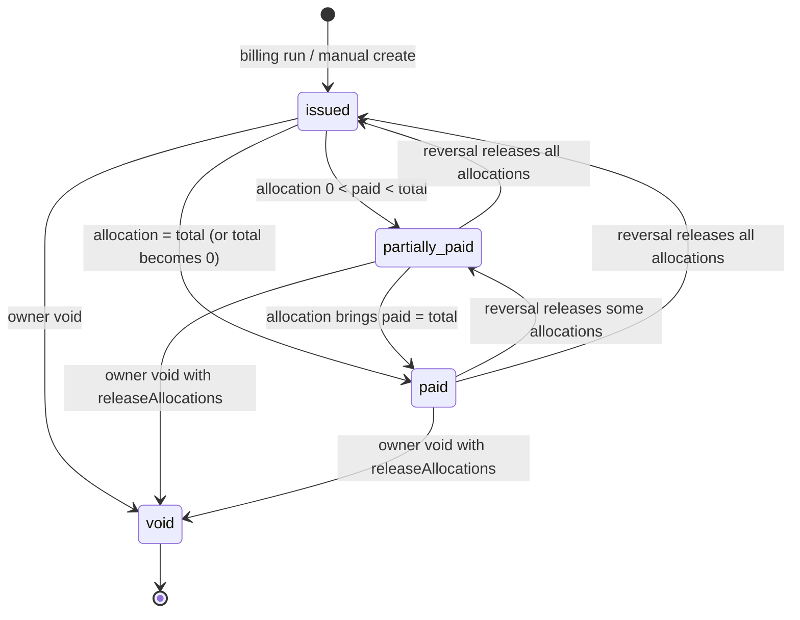
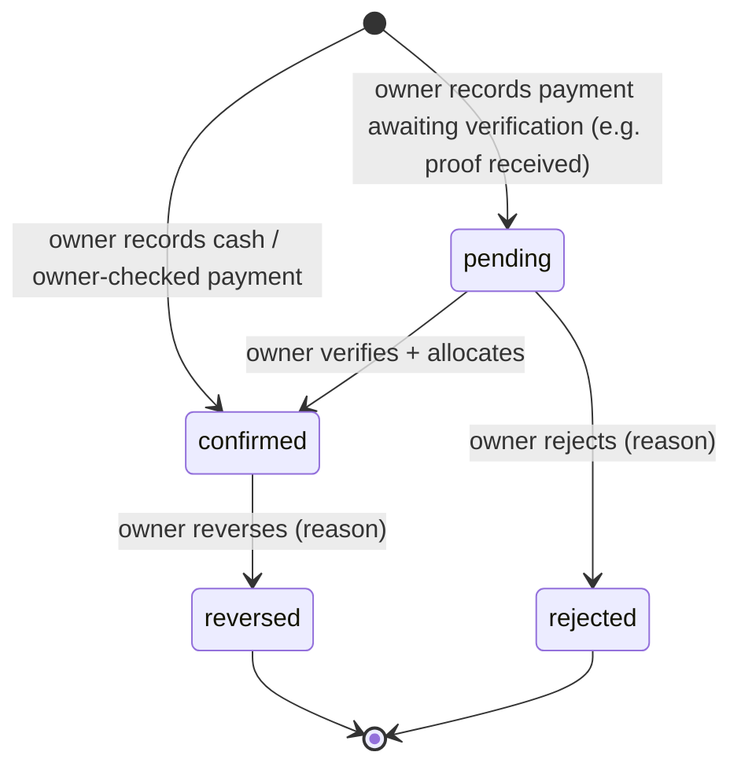

# BILLING_ENGINE

> **Status:** Draft v1 (planned) · **Owner:** Claude (spec) / Freebuff (implementation) · **Updated:** 2026-10-12
> **Depends on:** [DATABASE](DATABASE.md) · **Source of truth for:** every financial rule, state machine, formula and worked example. Endpoints live in [API_CONTRACTS](API_CONTRACTS.md); if a rule here and a rule elsewhere disagree, **this file wins**.

## 1. Principles (never violate)

1. Money is an integer in minor units (`*_minor`, 1 LKR = 100). No floats anywhere: DB, API JSON, JS (`number` is safe for ≤ 2^53, cap is LKR 100 M), PDFs.
2. Issued invoices are **immutable snapshots**. Only void, or append a **negative** adjustment.
3. An uploaded proof is evidence, **not** payment. Only an owner-confirmed payment (or an owner-recorded cash payment) changes a balance.
4. Balances are derived from allocations. `invoices.paid_minor` / `payments.allocated_minor` are caches maintained in the same transaction and verified by a deferred constraint trigger.
5. Every money-changing endpoint requires an `Idempotency-Key` and writes an audit row.
6. No network I/O (OpenWA, storage) inside a financial transaction.

## 2. Configuration inputs (`academy_settings`, `group_fees`)

| Setting | Values | Default |
|---|---|---|
| `billing_frequency` | `weekly`, `monthly` | `monthly` |
| `billing_period_mode` | `calendar`, `anchored` | `calendar` |
| `invoice_issue_timing` | `period_start` (in advance), `period_end` (arrears) | `period_start` [OPEN-006] |
| `due_rule_type` / `due_rule_value` | `days_after_issue` N · `days_after_period_start` N · `fixed_day_of_month` D (1–28, monthly only) | `days_after_issue`, 7 |
| `allow_fractional_money` | bool | `false` (all amounts multiples of LKR 1) |
| Fee | `group_fees` row effective on the reference date (§4) | — |

Changing any setting is audited and affects **only future** invoices.

## 3. Rule 1 — Billing periods

| Mode | Monthly | Weekly |
|---|---|---|
| `calendar` | start = 1st of month, end = last day | start = `week_start_day` (default Monday), end = start + 6 |
| `anchored` | player's *n*-th period: start = `billing_anchor_date + n months` (day clamped to month length, **always computed from the anchor**, never from the previous start, so 31 Jan → 28 Feb → 31 Mar), end = next start − 1 | start = anchor + 7n days, end = start + 6 |

Periods are **computed, not stored**; the invoice stores `period_start/period_end`. `billing_anchor_date` defaults to `registration_date` and is editable only while the player has no non-void periodic invoice.

## 4. Rules 2 & 5 & 6 — Who is invoiced, with which group and fee

For target date `T` (academy-local date) the **current period** of a player is the period containing `T` (`period_start` issue timing) or the period that ended most recently before `T` (`period_end` timing). Let `P` be that period and `R = max(P.start, player.registration_date)` the **reference date**.

A player is invoiced for `P` iff **all** hold:

1. `status` on `P.start` is `active` (status history is derived from `status_effective_date` + audit; a player set `inactive`/`withdrawn` with effective date ≤ `P.start` is skipped).
2. `registration_date <= P.end`.
3. A `player_group_history` row covers `R` (else skipped: `NO_GROUP`).
4. A `group_fees` row for that group covers `R` (else skipped: `NO_FEE`).
5. No row exists in `invoices` with the same `(player_id, period_start, period_end)` that is non-void **or** void with `suppress_reissue = true`.

The invoice stores group, fee, and period in `snapshot`. Fee for the invoice = fee effective on `R` ⇒ a fee change effective 1 Dec affects the December invoice but never November's.

**Anchored mode** applies the same test per player using that player's own period containing `T`. At most **one** period per player per run; a player who is behind shows a "behind by N periods" warning in the preview and is caught up by later runs with an earlier `targetDate`.

**Skipped players** are listed in the preview with reason codes (`NO_GROUP`, `NO_FEE`, `NOT_ACTIVE`, `ALREADY_INVOICED`, `NOT_YET_REGISTERED`). One skipped player never blocks the run.

## 5. Rule 3 — Due dates

| Rule | `due_date` |
|---|---|
| `days_after_issue` N | `issue_date + N` |
| `days_after_period_start` N | `period_start + N` |
| `fixed_day_of_month` D | day D of the month of `period_start` |

Final guard: `due_date = max(computed, issue_date)` (never due before issue). `issue_date` is the academy-local date the run executes.

## 6. Rule 4 — Registration partway through a period

| Mode | Behaviour |
|---|---|
| `anchored` | First period starts on the registration date. Nothing to prorate. |
| `calendar` | Player is billed the **full** fee for the period containing registration. The preview offers an optional **owner-entered negative adjustment** (reason required, e.g. "Joined 18th, half fee"). **No automatic proration** [OPEN-004: confirm policy]. |

## 7. Rules 7 — Status changes and withdrawals

- Setting a player `inactive`/`withdrawn` takes effect on `status_effective_date`; no invoices are generated for periods starting on/after it.
- **Existing unpaid invoices remain collectible.** The owner may void or waive (negative adjustment) explicitly; nothing auto-voids.
- Withdrawal UI offers "Stop reminders for this player's open invoices" (default **on**) → queued reminders are `skipped` with `skip_reason='player_withdrawn'`.
- Reactivation does not back-bill the gap. Owner may run a manual billing run for a past `targetDate` if desired (preview shows it).

## 8. Transfers between groups (Rule 5, restated)

A transfer closes the open `player_group_history` row and opens a new one effective on the chosen date (T7). History, attendance, invoices, payments are untouched. Billing consequence: the **next** invoice whose reference date `R` is ≥ transfer date uses the new group and fee. A mid-period transfer never rewrites the already-issued invoice [OPEN-005: if a top-up/refund for the difference is wanted, the owner uses an adjustment or void + reissue].

## 9. Rules 14–16 — Preventing duplicates; re-runs; concurrency

| Guard | Mechanism |
|---|---|
| One invoice per player-period | partial UQ on `invoices (player_id, period_start, period_end)` for periodic non-void (or void + `suppress_reissue`) |
| Re-running the scheduler | `billing_runs.run_key` UQ: scheduler key = `scheduler:{targetDate}`; manual key = `manual:{Idempotency-Key}`. A repeated key returns the stored run. Even with a different key, step above makes invoice insertion `ON CONFLICT DO NOTHING` and the run reports `skipped: ALREADY_INVOICED`. |
| Two runs at the same moment | transaction-scoped advisory lock `pg_advisory_xact_lock(hashtext('billing_run'))`; second waits, then finds everything `ALREADY_INVOICED`. |
| Retried HTTP request | `Idempotency-Key` (72 h): same key + same body → stored response; same key + different body → 422 `IDEMPOTENCY_KEY_REUSED`. |
| Stale preview | Issue request carries `previewHash`; server recomputes; mismatch → 409 `PREVIEW_STALE`. |
| Double allocation | payment row `FOR UPDATE` → invoices `FOR UPDATE` ascending id → re-check `remaining = amount − allocated` and `balance` **after** locking → UQ `(payment_id, invoice_id)` active → deferred trigger. |
| Duplicate payment | UQ `(method_code, lower(reference))` for pending/confirmed + idempotency. Cash payments with no reference rely on idempotency + UI duplicate warning (same guardian, amount, date). |
| Deadlock avoidance | fixed lock order payment → invoices ascending id. App retries a transaction up to 3× on `40001`/`40P01`. |

Isolation: `READ COMMITTED` with explicit row locks and constraints (simpler and fully sufficient here). Void/reissue after an accidental void: owner voids with `allowReissue=true`, then creates the corrected invoice via manual invoice or a rerun for that player (preview limited to `playerIds`).

**Scheduler:** daily 02:00 `Asia/Colombo` runs `scheduler:{today}` for every period boundary due; also runs the session generator, reminder scheduler, health checks. If the worker was down for days, the owner uses a manual run with an earlier `targetDate`.

**Invoice numbers:** `INV-{yyyy}-{000001}` from `document_counters('invoice', year)` incremented inside the issuing transaction; year = academy-local issue year; counter resets each year. Void invoices keep their number; numbers are never reused.

## 10. Invoice lifecycle (Rule 12)



| State | Definition | Counts in outstanding? |
|---|---|---|
| `issued` | `paid_minor = 0`, `total_minor > 0` | yes |
| `partially_paid` | `0 < paid_minor < total_minor` | yes (balance only) |
| `paid` | `paid_minor = total_minor` | no |
| `void` | cancelled, `paid_minor = 0` | **never** |
| *overdue* (derived) | `status ∈ {issued, partially_paid}` **and** `due_date < today(academy tz)` | yes; flagged overdue |

There is deliberately **no `draft`** state ([ADR-006](../engineering/DECISIONS.md#adr-006)); the billing **preview** serves that purpose and nothing is stored until issue.

**Allowed corrections**

| Need | Action | Effect |
|---|---|---|
| Wrong amount, nothing paid | Void (reason) → reissue | new number, new snapshot |
| Wrong amount, partly/fully paid | Void with `releaseAllocations=true` (payments become credit) → reissue → re-allocate | audited chain |
| Small waiver / discount after issue | Append **negative adjustment** (reason, ≤ remaining balance) | `total` decreases, `adjustments_minor` negative, PDF regenerated with an "Adjusted" line; if it brings balance to 0 → `paid` |
| Increase after issue | **Not allowed**; void + reissue | — |

Void rules: owner only; reason required; cancels `queued` messages; revokes access tokens; `suppress_reissue = NOT allowReissue` (default suppress, so the daily scheduler cannot recreate it).

## 11. Payment lifecycle (Rules 8–11)



- **Cash** → recorded directly as `confirmed`; proof optional.
- **Bank transfer / other** → `reference` required (setting). Owner may attach proof files at any time (`payment_proofs`), and chooses `confirmed` (they checked the bank statement) or `pending` (to be verified). Attaching a proof **never** changes status — and no verification result changes it either: the findings from a bank receipt never confirm, reject, allocate or produce a receipt, and `pending → confirmed` stays an owner action (`PAY-04`) whatever the checks say. Document kinds, check levels and the findings vocabulary live in [PAYMENT_VERIFICATION](PAYMENT_VERIFICATION.md) ([ADR-021](../engineering/DECISIONS.md#adr-021)).
- Only `confirmed` payments can have allocations, receipts, or affect any balance.
- Allocation to **multiple invoices / players** (siblings) is allowed in one payment; every `amountMinor > 0`, sum ≤ payment amount, each ≤ invoice balance, invoices not void.
- **Default suggestion** (UI/server helper): oldest `due_date` first, then `invoice_number`, across all invoices of the payer guardian's players; owner can edit before submitting.
- **Excess / credit:** unallocated remainder stays on the payment as credit (`amount − allocated`). It is **never auto-applied** [OPEN-007]; the owner allocates later via "Allocate credit". Credit per guardian = Σ remainders of confirmed payments with that `payer_guardian_id`. Cash refunds are out of scope: record as a reversal with a note.
- **Correcting a confirmed payment:** amount, method and allocations are immutable. `reference`, `notes`, `received_at` (date correction) editable with audit. To fix anything else: **reverse** (reason) then record a new payment. Reversal reverses all active allocations, recomputes invoices, voids the receipt (`receipts.voided_at`).
- **Receipts** exist only for `confirmed` payments; a reversed payment's receipt PDF carries a "VOID – payment reversed" watermark on regeneration.

## 12. Rule 13 — Overdue and balances

```
today        = current date in academy timezone
isOverdue    = status IN ('issued','partially_paid') AND due_date < today
daysOverdue  = today - due_date            (only if isOverdue)
outstanding  = Σ balance_minor  WHERE status IN ('issued','partially_paid')
overdueAmt   = Σ balance_minor  WHERE isOverdue
invoiced     = Σ total_minor    WHERE status <> 'void' AND issue_date IN range
collected    = Σ allocated active allocations (or confirmed payments.amount) with payments.received_at date IN range   -- see §14
```
Day boundaries use the academy timezone everywhere (never server-local, never UTC dates).

## 13. Worked examples (LKR)

Setup: monthly, calendar, due = 7 days after issue, U12 fee LKR 4,000 (400000 minor).

| # | Scenario | Result |
|---|---|---|
| 1 | Run for Nov 2026 on 2026-11-01 | Invoice `INV-2026-000101`, total 4,000.00, issued 11-01, due 11-08, status `issued`. Second run same day: 0 created, N skipped `ALREADY_INVOICED`. |
| 2 | Partial: owner records cash 1,500 and allocates to 101 | `paid=150000`, balance 2,500.00, `partially_paid`. Then 2,500 cash → `paid`, balance 0. Two receipts (RCT-…) exist, each referencing its own allocation. |
| 3 | Siblings: one bank transfer 10,000 (ref `TRX99`) for invoices A (4,000) and B (4,000) | allocations 4,000 + 4,000; credit 2,000 remains on the payment; both invoices `paid`; one receipt listing both allocations and "Unallocated credit 2,000.00". |
| 4 | Fee changed to 4,500 effective 2026-12-01 | INV-…101 (Nov) still 4,000; December invoice 4,500. PDFs of Nov unchanged on regeneration. |
| 5 | Player transfers U12 → U14 on 2026-11-15 (U14 fee 5,000) | Nov invoice unchanged; Dec invoice 5,000 under U14; `player_group_history` keeps both rows; Nov attendance stays with U12 sessions. |
| 6 | Payment 4,000 confirmed against 101 by mistake (wrong player) → owner reverses | allocation reversed, invoice → `issued`, receipt voided, audit rows for reverse; owner records the correct payment. |
| 7 | Overdue: 101 unpaid, today 2026-11-12 | `isOverdue`, `daysOverdue = 4` (due 11-08). Void invoices never appear. |
| 8 | Concurrency: invoice balance 4,000; two requests each allocate 3,000 simultaneously | Both lock invoice; first commits (balance 1,000); second sees balance 1,000 < 3,000 → 409 `ALLOCATION_EXCEEDS_BALANCE`; no partial writes. |
| 9 | Mid-month join (calendar) on 11-18 | Billed 4,000 for Nov unless owner adds adjustment −2,000 "half month" during preview. |
| 10 | Voided with `allowReissue=false`; scheduler runs again | No new invoice for that period (tombstone via `suppress_reissue`). |

## 14. Reporting definitions (referenced by dashboard/reports)

| Metric | Definition |
|---|---|
| Invoiced amount | `Σ total_minor` of non-void invoices by `issue_date` |
| Collected amount | `Σ payments.amount_minor` where `status='confirmed'` and `received_at` (academy date) in range — **cash actually received**, regardless of allocation |
| Allocated to period | `Σ active allocations` by `allocated_at` in range (used in reconciliation report) |
| Outstanding | per §12; **as of now**, not as of range |
| Credit held | Σ unallocated remainders of confirmed payments |
Dashboards must label *Invoiced* and *Collected* distinctly and never sum them.

## 15. Validation

| Field | Rule |
|---|---|
| Amount input (API) | integer `amountMinor`, `1..10_000_000_000`; if `allow_fractional_money=false` must be divisible by 100 |
| UI → API | UI parses decimal strings with a strict parser (`^\d{1,9}(\.\d{1,2})?$`) into integer minor units; no `parseFloat`, no `*100` on floats |
| Display | `LKR 4,000.00` in PDFs; UI shows `Rs. 4,000` when whole, `Rs. 4,000.50` otherwise (`en-LK` grouping). **Verify** `Intl` output on target browsers before final UI. |
| Adjustment | negative only after issue; `|adj| ≤ balance`; reason 5–200 chars |
| Payment date | `received_at` ≤ now + 1 day; > 1 year in the past requires owner confirmation flag |
