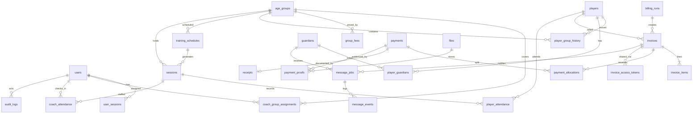

# DATABASE

> **Status:** Draft v1 (planned, not implemented) · **Owner:** Claude (spec) / Freebuff (implementation) · **Updated:** 2026-10-11
> **Depends on:** [BILLING_ENGINE](BILLING_ENGINE.md), [AUTH_AND_PERMISSIONS](AUTH_AND_PERMISSIONS.md) · **Source of truth for:** table/column names, constraints, indexes, retention, RLS intent

SQL DDL is deliberately **not** written here. Freebuff writes migrations from this spec. If a migration must deviate, follow [CHANGE_MANAGEMENT](../engineering/CHANGE_MANAGEMENT.md).

## 1. Conventions

| Topic | Rule |
|---|---|
| Engine | PostgreSQL 16+ (managed). Extensions: `citext`, `pg_trgm`, `btree_gist`, `pgcrypto`. |
| Primary keys | `id uuid` (UUIDv7 generated by the app so ids sort by time). |
| Timestamps | `timestamptz`, stored UTC. Columns: `created_at`, `updated_at` (all mutable tables). Display timezone comes from `academy_settings.timezone` (default `Asia/Colombo`). |
| Dates | `date` for business dates (due date, DOB, registration date, session date). Business dates are **academy-local**, never UTC-shifted. |
| Money | `bigint` **minor units** (1 LKR = 100 minor units). Columns end in `_minor`. Never `float`/`numeric` for balances. CHECK `>= 0` unless stated. Sanity cap `<= 10_000_000_000` (LKR 100 million). |
| Currency | `currency char(3)` fixed to `LKR` in v1 (CHECK `= 'LKR'`; column exists for forward compatibility). |
| Enums | `text` + CHECK constraint (easier to migrate than PG enums). Values listed below are exhaustive. |
| Naming | tables plural `snake_case`; FK = `<entity>_id`; booleans `is_*`/`has_*`. API uses camelCase of the same names. |
| Optimistic locking | `version integer not null default 1` on mutable financial/attendance rows; incremented on every update. |
| Soft delete | Not used except `archived_at` (age groups) and `deleted_at` (files). People and financial rows are never hard-deleted by the app (see §6). |
| Text | Names are Unicode (Sinhala/Tamil/English). One `full_name` field; never split into first/last. Max 120 chars. Trim + NFC-normalize in the API. |
| Phones | `phone_e164 text` e.g. `+94771234567`. CHECK `~ '^\+[1-9][0-9]{7,14}$'`. API accepts local `077…` and normalizes (default region LK). |

## 2. Candidate-entity consolidation

| Candidate (prompt) | Decision |
|---|---|
| Billing plans and schedules | `academy_settings` (frequency, period mode, due rule) + `group_fees` (per-group, effective-dated). One academy, one active plan. |
| Message jobs + message logs | `message_jobs` (current state) + `message_events` (append-only status history). |
| Payment proofs + file metadata | `files` (generic metadata) + `payment_proofs` (link). |
| Guardians | Many-to-many `player_guardians` (siblings share one guardian row and one consent record). |
| Billing periods | **No table.** Periods are computed; `invoices.period_start/period_end` snapshot them. `billing_runs` records each run for idempotency/audit. |
| Receipts | Own table: a receipt is a numbered document tied to one confirmed payment. |

## 3. Tables

Format: `field: type [null?] – notes`. **Access** = who may read/write (see [AUTH_AND_PERMISSIONS](AUTH_AND_PERMISSIONS.md)); RLS = enforced by Postgres policy in addition to the API (§7).

### 3.1 Settings and identity

**`academy_settings`** – single row (`id smallint PK CHECK (id = 1)`).
```
name text; short_name text null; address text null; phone text null; email citext null
timezone text default 'Asia/Colombo'; currency char(3) default 'LKR'
logo_file_id uuid null FK→files
payment_instructions text null          -- printed on invoices (bank details etc.)
billing_frequency text                   -- 'weekly' | 'monthly'
billing_period_mode text                 -- 'anchored' | 'calendar'
week_start_day smallint default 1        -- 1=Mon..7=Sun (calendar+weekly)
invoice_issue_timing text default 'period_start'   -- 'period_start' (in advance) | 'period_end' (arrears)  [OPEN-006]
due_rule_type text                       -- 'days_after_issue' | 'days_after_period_start' | 'fixed_day_of_month'
due_rule_value smallint                  -- days, or day-of-month 1..28
age_reference_rule text default 'jan_1_of_year'    -- 'jan_1_of_year' | 'fixed_month_day' | 'today'  [OPEN-003]
age_reference_month_day text null        -- 'MM-DD' when fixed_month_day
allow_fractional_money boolean default false       -- false: all amounts must be multiples of 100 minor
coach_can_see_guardian_phone boolean default false -- [OPEN-008]
attendance_coach_edit_window_hours smallint default 24
coach_checkin_opens_minutes_before smallint default 60
coach_checkin_closes_minutes_after_end smallint default 120
messaging_automation_enabled boolean default false  -- MASTER switch (MSG-07 pause/resume); every per-automation flag below must ALSO be true
messaging_automation_invoice_delivery boolean default false   -- SET-08 (CR-003)
messaging_automation_reminder_pre_due boolean default false   -- SET-08 (CR-003)
messaging_automation_reminder_overdue boolean default false   -- SET-08 (CR-003) "late reminders"
messaging_automation_proof_check boolean default false        -- SET-08 (CR-003/CR-004): runs the L1/L2 bank-receipt checks (extraction + cross-check) on upload; never auto-confirms (ADR-020/ADR-021); a manual re-check (PRF-04) is always allowed
messaging_send_window_start time default '09:00'; messaging_send_window_end time default '19:00'
messaging_provider text default 'openwa'
messaging_invoice_mode text default 'link'          -- 'link' | 'attachment_and_link' (attachment = document send, supported; gated on spike S1 media test, not a paid tier)
messaging_pacing_min_seconds smallint default 20; messaging_pacing_max_seconds smallint default 60; messaging_max_per_hour smallint default 40
messaging_opt_out_keywords text[] default '{STOP}'
invoice_link_ttl_days smallint default 30
updated_by uuid FK→users; updated_at timestamptz
```
Invariants: `due_rule_type='fixed_day_of_month'` ⇒ `billing_frequency='monthly'` and `due_rule_value BETWEEN 1 AND 28`. Changing billing config never touches issued invoices. Access: owner R/W; coach reads only name/timezone/logo via `/auth/me`.

**`users`**
```
id; username citext UQ CHECK (username ~ '^[a-z0-9._-]{3,32}$'); full_name text; phone_e164 text null
role text CHECK in ('owner','coach'); status text CHECK in ('invited','active','disabled')
password_hash text null                  -- argon2id; null while invited
failed_login_count smallint default 0; locked_until timestamptz null
last_login_at timestamptz null; password_changed_at timestamptz null
totp_secret_enc bytea null; totp_enabled boolean default false   -- owners: recommended [OPEN-010]
created_by uuid null FK→users; created_at; updated_at
```
Invariant: at least one `owner` with `status='active'` must always exist (service layer inside a transaction with `SELECT … FOR UPDATE` on owner rows + a deferred constraint trigger). Rows are never deleted; disabling revokes sessions. `username` is the login identifier ([ADR-018](../engineering/DECISIONS.md#adr-018)): unique case-insensitively via `citext`, stored lower-case, and immutable after creation in v1 (a rename is a new user + re-invite). There is **no `email` column** on users — contact is `phone_e164`/WhatsApp; the `email` on `academies` is the academy's own contact address on PDFs, not a credential. Access: owner only (users read/update own profile via `/auth/me`).

**`user_sessions`**: `id text PK` (SHA-256 of session token; raw token only in the cookie), `user_id FK`, `created_at`, `last_seen_at`, `expires_at` (absolute), `idle_expires_at`, `ip inet`, `user_agent text`, `revoked_at null`, `revoked_reason null`. IDX `(user_id) WHERE revoked_at IS NULL`, `(expires_at)`. Purge 30 days after expiry.

**`user_invites`**: `id`, `user_id FK`, `token_hash text UQ`, `purpose` ('invite'|'password_reset'), `expires_at`, `used_at null`, `created_by FK`. Single use; 72 h TTL.

### 3.2 Groups and people

**`age_groups`**: `id`, `name text`, `min_age smallint null`, `max_age smallint null` (inclusive; age on the reference date), `sort_order smallint`, `archived_at null`, timestamps. CHECK `min_age <= max_age` when both set. UQ `lower(name)` WHERE `archived_at IS NULL`. Archive is blocked while active players are currently assigned (409 `AGE_GROUP_HAS_ACTIVE_PLAYERS`). Access: owner W; coach R for assigned groups (RLS).

**`group_fees`**: `id`, `age_group_id FK`, `amount_minor bigint CHECK > 0`, `effective_from date`, `effective_to date null`, `created_by`, `created_at`. EXCLUDE USING gist `(age_group_id WITH =, daterange(effective_from, effective_to,'[]') WITH &&)` → no overlaps. One amount per group, applying to the academy's single `billing_frequency`. A fee change = close current row (`effective_to = new_from − 1 day`) + insert new row in one transaction. `amount_minor` of an existing row is never updated. Access: owner only.

**`coach_group_assignments`**: `id`, `coach_user_id FK→users (role=coach)`, `age_group_id FK`, `assigned_from date`, `assigned_to date null`, `created_by`. EXCLUDE no-overlap per `(coach_user_id, age_group_id)`. Coach scope on date *D* = rows where `assigned_from <= D AND (assigned_to IS NULL OR assigned_to >= D)`. Access: owner W; coach R own rows.

**`players`**
```
id; registration_no text UQ        -- 'IA-0001' from document_counters
full_name text; date_of_birth date null
registration_date date; billing_anchor_date date   -- defaults to registration_date; editable only before first invoice
status text CHECK in ('active','inactive','withdrawn'); status_effective_date date; status_reason text null
notes text null (<=1000)           -- owner-only
coach_notes text null (<=500)      -- visible to assigned coaches
anonymized_at timestamptz null
created_by; created_at; updated_at; version
```
No photo column, no medical column (data minimisation; see [SECURITY_AND_PRIVACY](SECURITY_AND_PRIVACY.md)). IDX: `(status)`, trigram GIN on `full_name`, `(date_of_birth)`. Duplicate warning = same normalized name + DOB, or trigram similarity ≥ 0.6 with a shared guardian phone (API level, never a DB unique).

**`player_group_history`**: `id`, `player_id FK`, `age_group_id FK`, `effective_from date`, `effective_to date null`, `reason text null` (required on transfer), `changed_by FK`, `created_at`. EXCLUDE gist no-overlap per `player_id`. Partial UQ `(player_id) WHERE effective_to IS NULL` → at most one current group. A player has no open row only if `withdrawn` or not yet assigned ("assignment pending" in the UI). *Current group = the open history row.* No denormalized `current_age_group_id`.

**`guardians`**
```
id; full_name text; phone_e164 text; relationship text null
whatsapp_consent text CHECK in ('unknown','granted','revoked') default 'unknown'
consent_recorded_at timestamptz null; consent_source text null  -- 'registration_form','verbal','whatsapp_reply','owner_entry'
opted_out_at timestamptz null; notes text null; anonymized_at null; created_at; updated_at
```
IDX `(phone_e164)`. No UQ on phone (two guardians may share a number); duplicates are advisory.

**`player_guardians`**: PK `(player_id, guardian_id)`, `is_primary boolean`, `receives_invoices boolean default true`, `created_at`. Partial UQ `(player_id) WHERE is_primary`.

### 3.3 Billing and money

**`payment_methods`**: `code text PK` (`cash`, `bank_transfer`, `other`; owner-configurable), `label`, `requires_reference boolean`, `is_active boolean`, `sort_order`.

**`billing_runs`**: `id`, `run_key text UQ` (`scheduler:2026-11-01` or `manual:{Idempotency-Key}`), `frequency`, `period_mode`, `target_date date`, `status` ('issued','partial','failed'), `preview_hash text`, `invoices_created int`, `invoices_skipped int`, `summary jsonb`, `triggered_by` ('owner','scheduler'), `started_by uuid null`, `started_at`, `completed_at`. UQ on `run_key` is the primary duplicate-run guard ([BILLING_ENGINE](BILLING_ENGINE.md) §9).

**`invoices`**
```
id; invoice_number text UQ ('INV-2026-000123'); kind text ('periodic'|'manual')
player_id FK; guardian_id uuid null FK       -- billed-to guardian at issue
billing_run_id uuid null FK
period_start date null; period_end date null -- null for manual
issue_date date; due_date date
status text CHECK in ('issued','partially_paid','paid','void')
currency char(3); subtotal_minor bigint; adjustments_minor bigint default 0 (<=0); total_minor bigint CHECK >= 0
paid_minor bigint default 0 CHECK (paid_minor BETWEEN 0 AND total_minor)
balance_minor bigint GENERATED ALWAYS AS (total_minor - paid_minor) STORED
snapshot jsonb                               -- §4
version int; voided_at null; voided_by null; void_reason null
suppress_reissue boolean default false       -- true: void invoice still occupies its period
pdf_file_id uuid null FK→files; pdf_input_hash text null; pdf_generated_at null
pdf_stale boolean default true               -- set true in the same tx as any change that affects the PDF
created_by uuid null (null = scheduler); created_at; updated_at
```
Constraints: UQ partial `(player_id, period_start, period_end) WHERE kind='periodic' AND (status <> 'void' OR suppress_reissue)`. Status rules: `paid ⇔ paid_minor = total_minor` (including `total_minor = 0` after a full waiver); `void ⇒ voided_at NOT NULL AND paid_minor = 0`; `partially_paid ⇔ 0 < paid_minor < total_minor`; `issued ⇔ paid_minor = 0 AND total_minor > 0`. IDX: `(id) WHERE pdf_stale` (PDF worker sweep), `(player_id, due_date)`, `(due_date) WHERE status IN ('issued','partially_paid')`, `(billing_run_id)`, `(issue_date)`. **Overdue is derived, never stored** ([ADR-010](../engineering/DECISIONS.md)). Access: owner only (no coach policy).

**`invoice_items`**: `id`, `invoice_id FK`, `line_no smallint`, `item_type` ('fee','adjustment'), `description text`, `quantity int default 1`, `unit_amount_minor bigint` (negative only for `adjustment`), `amount_minor bigint` (= quantity × unit), `reason text null` (required for adjustment), `created_by`, `created_at`. UQ `(invoice_id, line_no)`. Invariant (txn + deferred trigger): `subtotal_minor = Σ fee`, `adjustments_minor = Σ adjustment`, `total = subtotal + adjustments`. After issue only **negative** adjustments may be appended.

**`payments`**
```
id; amount_minor bigint CHECK > 0; currency; method_code FK→payment_methods
reference text null; received_at timestamptz; payer_guardian_id uuid null FK; payer_name text null
status text CHECK in ('pending','confirmed','rejected','reversed')
confirmed_at/by; rejected_at/by/reason; reversed_at/by/reason
notes text null; version; created_by; created_at; updated_at
allocated_minor bigint default 0   -- cache of Σ active allocations; CHECK BETWEEN 0 AND amount_minor
```
UQ partial `(method_code, lower(reference)) WHERE reference IS NOT NULL AND status IN ('pending','confirmed')`. Credit = `amount_minor − allocated_minor` on a `confirmed` payment. `pending` payments hold **no** allocations and count in no balance.

**`payment_allocations`**: `id`, `payment_id FK`, `invoice_id FK`, `amount_minor bigint CHECK > 0`, `allocated_at`, `allocated_by`, `reversed_at null`, `reversed_by null`, `reverse_reason null`. UQ partial `(payment_id, invoice_id) WHERE reversed_at IS NULL`. Rows are never updated except to set `reversed_*`; never deleted. Invariants (enforced in the transaction **and** a deferred constraint trigger): payment is `confirmed`; `Σ active per payment = payments.allocated_minor ≤ amount_minor`; `Σ active per invoice = invoices.paid_minor ≤ total_minor`; invoice not `void`.

**`payment_proofs`**: `id`, `payment_id FK`, `file_id FK→files`, `uploaded_by`, `created_at`, `note null`, `doc_kind text` (`'bank_receipt_pdf'|'bank_receipt_image'|'other'`, derived from the sniffed type — CR-004), `verification jsonb null` (`{status, extracted, findings[], parserVersion}`), `checked_at timestamptz null`. Max 5 per payment. **A proof never changes payment status.** Only `doc_kind='bank_receipt_pdf'` can reach a checked status; anything else is `supporting_only`/`unverifiable` ([PAYMENT_VERIFICATION](PAYMENT_VERIFICATION.md), [ADR-021](../engineering/DECISIONS.md#adr-021)). Extraction findings are advisory and auditable; `parserVersion` is stored so old results stay explainable when a bank's layout changes. Access: owner only (RLS deny for coaches, §7); extracted values may contain payer names/account masks and are treated as proof-class PII (never logged).

**`receipts`**: `id`, `receipt_number text UQ ('RCT-2026-000045')`, `payment_id FK UQ`, `issued_at`, `file_id null FK→files`, `pdf_input_hash null`, `pdf_stale boolean default true`, `voided_at null` (set on payment reversal). Row created in the transaction that confirms the payment; PDF generated after commit ([FILES_AND_PDF](FILES_AND_PDF.md)).

**`document_counters`**: PK `(name, year)`, `next_value bigint`; names `invoice`, `receipt`, `player_reg`. Incremented in the issuing transaction via `UPDATE … RETURNING` (row lock) → unique numbers, no gaps from rollbacks.

### 3.4 Files and links

**`files`**: `id`, `kind` ('payment_proof','invoice_pdf','receipt_pdf','logo','import_csv'), `storage_key text UQ`, `mime_type`, `size_bytes bigint`, `sha256 text`, `original_name null`, `uploaded_by null`, `created_at`, `deleted_at null`. Contents live in private object storage; **never** in Postgres.

**`invoice_access_tokens`**: `id`, `invoice_id FK`, `guardian_id null FK`, `token_hash text UQ` (SHA-256 of 32 random bytes; raw token appears only in the outgoing message), `expires_at`, `revoked_at null`, `use_count int default 0`, `last_used_at null`, `created_by`. Auto-revoked on void.

### 3.5 Attendance

**`training_schedules`**: `id`, `age_group_id FK`, `weekday smallint (1–7)`, `start_time time`, `end_time time`, `venue null`, `valid_from date`, `valid_to date null`, `is_active boolean`, `created_by`, timestamps. Times are academy-local. Tue/Thu are **seed data**, not code.

**`sessions`**: `id`, `age_group_id FK`, `schedule_id uuid null FK`, `session_date date`, `starts_at timestamptz`, `ends_at timestamptz`, `venue null`, `status` ('scheduled','completed','cancelled'), `cancel_reason null`, `lead_coach_user_id uuid null FK`, `notes null`, `created_by`, timestamps, `version`. UQ partial `(schedule_id, session_date) WHERE schedule_id IS NOT NULL`; UQ partial `(age_group_id, starts_at) WHERE status <> 'cancelled'`. IDX `(age_group_id, session_date)`, `(session_date)`.

**`player_attendance`**: `id`, `session_id FK`, `player_id FK`, `status` ('present','absent','late','excused'), `note null (<=500)`, `marked_by`, `marked_at`, `updated_by null`, `updated_at`, `version`. UQ `(session_id, player_id)`. IDX `(player_id, session_id)`. Roster rule (API 422 `PLAYER_NOT_ON_ROSTER`): player's group history covers `session_date` for the session's group and the player is `active` on that date. No row = "not yet marked".

**`coach_attendance`**: `id`, `coach_user_id FK`, `session_id FK`, `check_in_at timestamptz`, `check_out_at null`, `check_in_note null`, `entered_by` ('self','owner'), `corrected boolean default false`, `version`, timestamps. UQ `(coach_user_id, session_id)`; partial UQ `(coach_user_id) WHERE check_out_at IS NULL`; CHECK `check_out_at > check_in_at`.

### 3.6 Messaging

**`message_templates`**: PK `key` (`invoice_delivery`, `reminder_pre_due`, `reminder_overdue`), `body text`, `locale default 'en'`, `is_active`, `updated_by`, `updated_at`. Variables: `{{guardianName}} {{playerName}} {{invoiceNumber}} {{amountDue}} {{dueDate}} {{invoiceLink}} {{academyName}}`; unknown variables rejected on save.

**`reminder_rules`**: `id`, `kind` ('pre_due','overdue'), `offset_days smallint` (days before due / after due), `is_active`. UQ `(kind, offset_days)`. Defaults: pre_due 3, 1; overdue 1, 7, 14.

**`message_jobs`** (queue **and** owner-visible log)
```
id; kind ('invoice_delivery','reminder_pre_due','reminder_overdue')
invoice_id FK; guardian_id FK; to_phone_e164 text (snapshot)
template_key; rendered_body text (snapshot); attachment_file_id uuid null
dedupe_key text UQ                 -- 'reminder_pre_due:{invoiceId}:{guardianId}:d3'
status ('queued','sending','sent','failed','dead','needs_review','cancelled','skipped')
skip_reason text null              -- 'no_consent','opted_out','invoice_paid','invoice_void','automation_paused','no_phone','player_withdrawn'
scheduled_for timestamptz; next_attempt_at timestamptz; attempts smallint default 0; max_attempts smallint default 5
locked_by text null; locked_at timestamptz null
provider text; provider_message_id text null; provider_ack smallint null    -- provider-native ack code: VERIFY (spike S1, OPENWA_INTEGRATION §2 O19) — do not assume a numeric enum
delivery_state text default 'unknown' -- 'unknown','server_accepted','device_delivered','read','provider_error'
last_error_code text null; last_error_message text null
manual_fallback_by uuid null; manual_fallback_at null; manual_fallback_note null
created_by null; created_at; updated_at; sent_at null
```
IDX `(status, next_attempt_at) WHERE status IN ('queued','failed')` (worker poll), `(invoice_id)`, `(guardian_id)`, `(provider_message_id)`. `delivery_state` becomes `device_delivered`/`read` **only** from a provider-reported ack event ([OPENWA_INTEGRATION](OPENWA_INTEGRATION.md)); until spike S1 confirms OpenWA's ack semantics the adapter must emit only `server_accepted`/`unknown`.

**`message_events`** (append-only): `id bigint identity`, `message_job_id FK`, `event_type` ('queued','attempt_started','provider_accepted','provider_error','ack','retry_scheduled','manual_retry','cancelled','manual_fallback','needs_review'), `provider_ack smallint null`, `payload jsonb` (sanitized; never secrets), `occurred_at`. Retention 18 months.

**`integration_health`**: `id`, `integration` ('openwa','storage'), `status` ('healthy','degraded','down','unknown'), `detail jsonb`, `checked_at`. Latest row per integration drives the dashboard; 30-day retention.

### 3.7 Platform

**`idempotency_keys`**: PK `(user_id, key)`, `method`, `path`, `request_hash`, `state` ('in_progress','completed'), `response_status`, `response_body jsonb`, `created_at`, `expires_at` (+72 h). Same key + different `request_hash` ⇒ 422 `IDEMPOTENCY_KEY_REUSED`.

**`audit_logs`** (append-only): `id bigint identity`, `occurred_at`, `actor_user_id null`, `actor_role`, `action text` (`player.create`, `invoice.void`, …), `entity_type`, `entity_id`, `before jsonb null`, `after jsonb null`, `reason null`, `request_id`, `ip inet null`, `prev_hash text`, `row_hash text` (SHA-256 of `prev_hash` ‖ canonical JSON of the row). The runtime DB role has **INSERT and SELECT only**. A daily job verifies the chain and writes the latest hash to an append-only object in storage. Secrets are never logged; guardian phone numbers in `before/after` are masked (`+9477****567`).

**`import_batches`**: `id`, `kind` ('players'), `file_id`, `status` ('validated','committed','rejected'), `row_count`, `error_count`, `report jsonb`, `created_by`, `created_at`, `committed_at null`. See [CSV_IMPORT](../engineering/CSV_IMPORT.md).

## 4. Invoice snapshot (`invoices.snapshot`)

```
{
 "player":   {"id","registrationNo","fullName"},
 "guardian": {"id","fullName","phoneMasked"} | null,
 "ageGroup": {"id","name"},
 "fee":      {"feeId","amountMinor","frequency","effectiveFrom"},
 "period":   {"start","end","mode"},
 "academy":  {"name","address","phone","email","logoFileId","paymentInstructions","timezone"},
 "rules":    {"dueRuleType","dueRuleValue","issueTiming"}
}
```
PDFs render **only** from `invoices` + `invoice_items` + `snapshot`, never from live settings or fees. Anonymization overwrites `player.fullName` and `guardian.*` inside snapshots.

## 5. ER diagram



## 6. Retention and deletion

| Data | Rule |
|---|---|
| Players/guardians | Never hard-deleted. Inactive/withdrawn players are retained. Erasure request ⇒ **anonymize** (`full_name='Anonymized player'`, clear DOB/notes/phones, set `anonymized_at`, scrub snapshots) once no unpaid invoice exists. |
| Invoices, payments, receipts, allocations | Retain **7 years** after the financial year [OPEN-009: confirm with the academy's accountant]. Only voided/reversed, never deleted. |
| Payment proofs | Delete file objects 24 months after payment confirmation unless owner extends [OPEN-009]; metadata row kept with `deleted_at`. |
| Attendance | 3 years, then owner-initiated aggregate-and-purge. |
| `message_jobs`/`message_events` | 18 months. |
| `audit_logs` | 7 years; never purged by the app. |
| `user_sessions`, `idempotency_keys`, `integration_health` | 30 days / 72 h / 30 days after expiry. |

## 7. Row-level security (defense in depth)

- DB roles: `ia_migrator` (DDL, owns objects), `ia_app` (runtime; **no** `BYPASSRLS`, not table owner; `audit_logs`/`message_events` INSERT+SELECT only). The API never runs as a superuser.
- Each request transaction starts with `SET LOCAL app.user_id = '<uuid>'; SET LOCAL app.role = 'owner|coach'`. Helper functions: `app_user_id()`, `app_role()`, `app_coach_group_ids(on_date)`.
- `ENABLE` + `FORCE ROW LEVEL SECURITY` on every table below.

| Table | Owner policy | Coach policy |
|---|---|---|
| `invoices`, `invoice_items`, `payments`, `payment_allocations`, `payment_proofs`, `receipts`, `files`, `invoice_access_tokens`, `group_fees`, `billing_runs`, `message_*`, `audit_logs`, `idempotency_keys`, `import_batches`, `user_invites`, `integration_health`, `document_counters`, `payment_methods`, `reminder_rules` | ALL | **none (deny)** |
| `players`, `player_group_history` | ALL | SELECT where the player's group on the row's date ∈ `app_coach_group_ids(today)` |
| `guardians`, `player_guardians` | ALL | **none**; guardian phone reaches coaches only through a restricted projection when `coach_can_see_guardian_phone = true` (`SECURITY DEFINER` view owned by `ia_migrator`) |
| `age_groups`, `training_schedules`, `coach_group_assignments` | ALL | SELECT where group ∈ own assignments |
| `sessions` | ALL | SELECT where `age_group_id` ∈ own assignments |
| `player_attendance` | ALL | SELECT/INSERT/UPDATE where session's group ∈ own assignments **and** within edit window |
| `coach_attendance` | ALL | SELECT/INSERT/UPDATE where `coach_user_id = app_user_id()` |
| `users` | ALL | SELECT/UPDATE own row |
| `academy_settings` | ALL | SELECT via limited-column view |

RLS is a backstop, not the primary control. The API authorizes every request explicitly, and tests must prove each layer **independently** denies a coach ([TESTING_AND_ACCEPTANCE](../engineering/TESTING_AND_ACCEPTANCE.md)).

## 8. Transaction boundaries

| ID | Operation | One transaction contains | Locks |
|---|---|---|---|
| T1 | Issue billing run | `billing_runs` insert (UQ run_key) → per player: counter, invoice, items, audit | UQ `run_key`; advisory lock `billing`; per-player invoice UQ |
| T2 | Confirm payment | lock payment → `confirmed` → allocations → invoice `paid_minor`/status → receipt + counter → audit | `FOR UPDATE` payment, then invoices **ascending id** |
| T3 | Allocate credit | as T2 without status change | same |
| T4 | Reverse payment | payment→`reversed`, reverse active allocations, recompute invoices, void receipt, audit | same order |
| T5 | Void invoice | invoice→`void`, optional release of allocations to payment credit, revoke tokens, cancel queued messages, audit | invoice, then payments ascending id |
| T6 | Fee change | close old fee + insert new | `FOR UPDATE` age group |
| T7 | Player transfer | close open history + insert new + audit | `FOR UPDATE` player |
| T8 | Bulk attendance | upsert N rows + one audit row per changed record | `FOR SHARE` session |
| T9 | Coach check-in | insert guarded by partial UQ | UQ |
| T10 | Message enqueue | `message_jobs` insert (UQ `dedupe_key`) | UQ |

Rules: lock order is always **payment → invoices (ascending id)**. No external HTTP (OpenWA, storage) inside T1–T10. PDF generation and WhatsApp sends happen **after commit** through the queue.

## 9. Index rationale

Expected scale: ≤ 600 players, ≤ 10k invoices/yr, ≤ 20k attendance rows/yr. Indexes target list pages (status/due), the worker poll, per-player lookups and uniqueness guards. Avoid N+1 by joining items/snapshots in list queries and batch-loading guardians. No extra index without an `EXPLAIN` showing need.

## 10. Migration conventions and seed data

- Forward-only SQL migrations, tool chosen by Freebuff (record as an ADR). One migration per logical change, named `NNNN_description`. CI applies all migrations from empty **and** onto a copy of the previous release schema.
- Destructive changes use expand → backfill → contract across ≥ 2 releases. Rollback = point-in-time restore or a compensating forward migration; each migration header states which.
- **Seed (all envs):** `academy_settings` row, payment methods (`cash`, `bank_transfer`), default reminder rules, default message templates, `document_counters`. **Dev-only seed:** 3 age groups, 20 obviously fake players, 1 owner, 2 coaches. The production first owner comes from a one-time bootstrap command ([DEPLOYMENT_AND_OPERATIONS](DEPLOYMENT_AND_OPERATIONS.md) §9).
