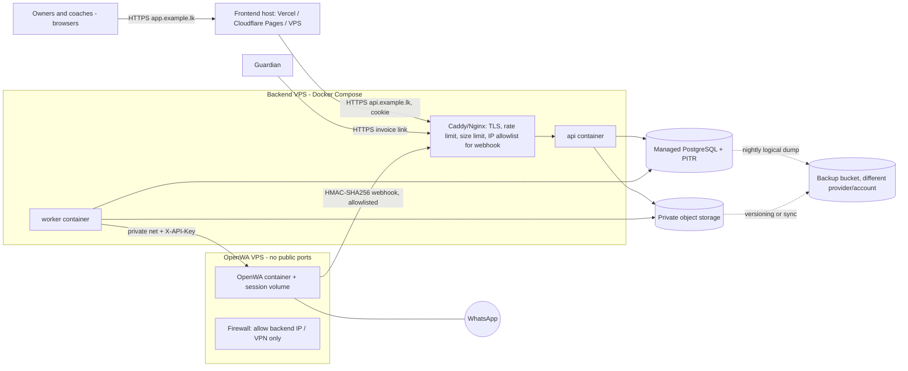

# DEPLOYMENT_AND_OPERATIONS

> **Status:** Draft v1 (planned) · **Owner:** Claude (spec) / Hassen (operator) + Freebuff · **Updated:** 2026-10-11
> **Depends on:** [OVERVIEW](OVERVIEW.md), [SECURITY_AND_PRIVACY](SECURITY_AND_PRIVACY.md), [OPENWA_INTEGRATION](OPENWA_INTEGRATION.md) · **Source of truth for:** topology, environments, env vars, backup/restore, release and rollback procedures.

## 1. Principle

Simplest topology that can securely meet the requirements: **no Kubernetes, no microservices, no message broker.** One API process, one worker process, one managed PostgreSQL, one private bucket, one small OpenWA VPS, one static/SSR frontend host.

## 2. Production topology

| Piece | Recommendation | Notes |
|---|---|---|
| Frontend | Static/SSR host with HTTPS and preview deploys | Domain `app.<academy-domain>` |
| API + worker | One VPS (2 vCPU / 2–4 GB) running Docker Compose: `api`, `worker`, reverse proxy | `api.<academy-domain>`; same registrable domain as the app so cookies are same-site |
| PostgreSQL | **Managed** with automated backups **and point-in-time recovery** | Provider choice at build time; must support extensions in [DATABASE](DATABASE.md) §1 and RLS; **verify** |
| Object storage | S3-compatible private bucket (R2/S3/Supabase Storage) | [OPEN-016] |
| OpenWA | Separate small VPS (≥ 1–2 GB RAM; `ENGINE_TYPE` **`baileys`** by default — browser-free, so no Chromium) in private network | Dedicated number; **no public port**; dashboard + `/api/docs` share the API port, so keep them VPN-only |
| DNS/TLS | Managed DNS, Let's Encrypt/Caddy auto-TLS or provider-managed | HSTS on |

Domain: owner registers a domain (`.lk` or `.com`); DNS records for `app`, `api`. [OPEN-017]

## 3. Environments

| Env | Purpose | Data | WhatsApp gateway |
|---|---|---|---|
| `dev` | Local Docker Compose (Postgres + MinIO + mock messaging) | Seeded fake data only | **Mock provider** (a fake `MessagingProvider` that records messages); never a real number |
| `staging` | Pre-prod with prod-like config, smoke/E2E | Fake data; **never** a copy of production PII | Optional second OpenWA instance with a test number, messages only to owner numbers |
| `prod` | Live | Real | Real dedicated number |

Separate secrets, databases, buckets, and domains per environment. Prod data is never restored into dev/staging without anonymization.

## 4. Environment variables (names only; values in secret store)

| Variable | Used by | Purpose |
|---|---|---|
| `NODE_ENV`, `APP_ENV` | all | `development|staging|production` |
| `APP_BASE_URL`, `API_BASE_URL` | api | absolute URLs (links, CORS, cookies) |
| `CORS_ALLOWED_ORIGINS` | api | exact frontend origin(s) |
| `COOKIE_DOMAIN`, `SESSION_COOKIE_SECRET`, `CSRF_SECRET` | api | session/CSRF |
| `DATABASE_URL` / `DATABASE_MIGRATOR_URL` | api,worker / CI | runtime role / DDL role |
| `STORAGE_ENDPOINT`, `STORAGE_REGION`, `STORAGE_BUCKET`, `STORAGE_ACCESS_KEY_ID`, `STORAGE_SECRET_ACCESS_KEY` | api,worker | object storage |
| `ACADEMY_TIMEZONE_DEFAULT` | api | seed default (`Asia/Colombo`) |
| `MESSAGING_PROVIDER` | worker | `openwa` or `mock` |
| `OPENWA_BASE_URL`, `OPENWA_API_KEY`, `OPENWA_SESSION_ID`, `OPENWA_WEBHOOK_SECRET` | api,worker | see [OPENWA_INTEGRATION](OPENWA_INTEGRATION.md) §12. `OPENWA_WEBHOOK_SECRET` matches the official example; the other three are our naming — exact OpenWA-side names: spike S1 |
| `WEBHOOK_ALLOWED_IPS` | proxy | OpenWA host IP(s) |
| `TOTP_ENCRYPTION_KEY` | api | encrypts TOTP secrets |
| `LOG_LEVEL`, `SENTRY_DSN` (optional) | all | observability |
| `AUDIT_ANCHOR_BUCKET`/`_PREFIX` | worker | external hash anchor |
| `BACKUP_*` | backup job | dump target + encryption key |

`.env.example` (committed) lists names with dummy values. The backend refuses to start if a required variable is missing/weak (e.g., secret < 32 bytes).

## 5. Release procedure (backend)

1. CI green on the release commit (lint, types, unit, integration, DB-constraint, contract, security tests; see release gate).
2. Build immutable image tagged with git SHA.
3. **Backup point**: confirm last automated backup < 24 h and take a manual snapshot/`pg_dump` for releases with migrations.
4. Run migrations with `ia_migrator` (expand-only changes first). Migration job must be idempotent and time-boxed.
5. Deploy `api` (health `GET /ready`), then `worker` (graceful shutdown: finish current job, release `sending` rows → they sweep to `needs_review` only if > 10 min).
6. Smoke test: login, `GET /system/health`, create/delete a throwaway test player in staging; in prod: read-only checks + health.
7. Watch error rate/queue 30 minutes. Update `PROJECT_STATUS.md` and release notes.

**Rollback:** (a) code-only: redeploy previous image (migrations are expand-compatible, so old code still runs). (b) migration problem: stop writes (maintenance flag), restore PITR to the pre-deploy timestamp **or** apply the migration's documented compensating migration; never hand-edit prod tables. Rollback criteria: error rate > 2 % for 10 min, any financial invariant check failing, or login broken.

Frontend release: build with `NEXT_PUBLIC_API_BASE_URL`; preview deployment verified against staging API; promote; rollback = redeploy previous build. Frontend must tolerate the API being **one minor version ahead** (ignore unknown fields).

## 6. Health checks and monitoring

| Signal | Source | Alert |
|---|---|---|
| API liveness/readiness | `GET /health`, `GET /ready` | external uptime monitor (e.g., hosted pinger) → owner/operator SMS/email |
| Worker heartbeat | `scheduler.lastRunAt` in `/system/health`; worker writes a row every minute | alert if > 5 min stale |
| Queue | oldest `queued` age, `dead`, `needs_review` counts | dashboard + daily digest [OPEN-012] |
| OpenWA | session status (60 s) | banner + alert |
| DB | connections, slow queries (> 500 ms logged), disk | provider alerts |
| Storage | PDF stale count, upload errors | `/system/health` |
| Backups | last backup status/time | alert if > 26 h |
| Errors | structured logs (+ optional Sentry-style tracker with PII scrubbing) | spike alert |
| Invariant job | nightly: `paid_minor = Σ allocations`, invoice totals = Σ items, no negative balances, orphan counts | failure ⇒ page the operator |

Log retention: 30 days hot; no PII beyond ids and masked phones.

## 7. Backup, restore and recovery objectives

| Item | Spec |
|---|---|
| Objectives | **RPO ≤ 15 min** with PITR (fallback RPO ≤ 24 h with nightly dump only); **RTO ≤ 4 h** [OPEN-017: owner confirms acceptable] |
| Database | Provider automated backups + PITR (retention ≥ 7 days) **and** a nightly encrypted logical dump (`pg_dump`) to a **separate provider/account**, kept 30 daily + 12 monthly. Dumps encrypted with a key stored apart from the backup bucket. |
| Files | Bucket versioning (or nightly sync to the backup bucket); proofs and PDFs retained per [DATABASE](DATABASE.md) §6. PDFs are re-creatable from data; **proofs are not**. |
| OpenWA | Session volume **and its own database** (SQLite file or PostgreSQL) snapshot, encrypted; loss ⇒ recreate the session and re-scan QR **or re-enter the pairing code** (credentials are wiped on unlink, [OPENWA_INTEGRATION](OPENWA_INTEGRATION.md) O16). |
| Config/secrets | Secret manager export procedure stored offline by the operator and one owner (sealed). |
| Restore test | **Before go-live and every quarter**: restore latest dump into an isolated DB, run the invariant job and a row-count/sample comparison, restore a proof file and a PDF, record date/duration/result in `docs/engineering/RESTORE_LOG.md` (created in M10). A backup that has never been restored is not a backup. |
| Responsible | Operator = Hassen (runs/tests); Academy owner = signs off the quarterly record. Backup provider changes need owner approval. |
| Disaster scenarios | DB lost → PITR; provider account compromised → restore from the other provider; VPS lost → redeploy image + secrets + point to DB; accidental deletion → PITR to just before + export affected rows. |

## 8. Scheduled work (all in the worker; advisory-locked, idempotent)

| Job | Cadence (academy tz) |
|---|---|
| Billing scheduler (`scheduler:{today}` run) | daily 02:00 |
| Session generation | daily 03:00 + on schedule save |
| Reminder enqueue | daily 08:30 |
| Message queue consumer | every 5 s |
| OpenWA health | every 60 s |
| PDF sweeper | every 30 s |
| Stuck-job & orphan-file sweepers | every 15 min / daily |
| Invariant verification, audit-chain verify + anchor | nightly 04:00 |
| Retention/purge (sessions, idempotency, health rows) | nightly 04:30 |
| Logical backup | nightly 01:00 (host cron or provider) |

If the worker is down, nothing is lost: next run catches up per the rules in [BILLING_ENGINE](BILLING_ENGINE.md) §9.

## 9. First-time setup, handover

**Bootstrap (one time):**
1. Provision DB, bucket, domains, VPSs; set secrets; run migrations; run seed (settings row, payment methods, reminder rules, templates, counters).
2. `create-owner --username <owner>` CLI on the server prints a one-time invite URL (72 h). The first owner sets a password and enrolls TOTP. No default credentials exist anywhere.
3. Owner configures: academy profile + **logo**, timezone, age rule, payment methods, **payment instructions**, billing frequency/mode/due rule, age groups with fees, schedules, coaches + assignments, messaging settings/templates, consent policy text.
4. Start OpenWA: link the dedicated number via QR **or pairing code** (over VPN), run `MSG-08` test to an owner's number, leave **automation paused** until owner records consent for guardians.
5. Import players via CSV ([CSV_IMPORT](../engineering/CSV_IMPORT.md)); review; do a **billing preview** for the first period; run it.

**Deployment checklist (go-live gate):** DNS + TLS valid · HSTS · cookies Secure · CORS exact · env secrets set and unique · DB roles verified (no superuser, RLS forced) · backup + **restore tested** · invariant job green · uptime monitor wired · OpenWA not reachable from the public internet (port scan) · webhook HMAC-SHA256 verified (negative test) · owner TOTP · release gate passed · privacy notice published · handover doc delivered.

**Operational handover pack** (to the academy owner): who operates what, how to add a coach, how to reconnect WhatsApp (QR or pairing code), how to read the dashboard banners, what to do on a bad invoice (void/reissue), how to request a backup restore, contacts, monthly checklist (verify backup status, review `dead`/`needs_review`, review audit anomalies).

## 10. Costs (structure; **figures are unverified estimates**)

| Category | Type | Items | Estimate guidance |
|---|---|---|---|
| Development (one-off) | Hassen/Freebuff/Claude effort | Frontend, backend, QA, deploy, data import, training | Project fee decided by Hassen — not estimated here |
| Recurring infra | Monthly/yearly | Backend VPS, OpenWA VPS, managed Postgres with PITR, object storage + backup storage, domain, monitoring, frontend host | **ESTIMATE — verify at build time.** Typical small-scale ranges: VPS roughly USD 5–15 each, managed Postgres USD 0–25+ (free tiers are **not** assumed for production), storage a few USD, domain ~USD 10–40/yr |
| Messaging software | **None** | OpenWA is MIT-licensed and self-hosted with **no paid tier and no feature gates**; document/PDF sending is included (verified 2026-10-11) | Settled — `OPEN-002` is resolved; see [OPENWA_INTEGRATION](OPENWA_INTEGRATION.md) O1/O23 |
| Messaging account | Recurring | Dedicated SIM/phone plan | academy cost |
| Ops time | Recurring | Monthly checks, quarterly restore test, patching | budget ≥ 2–3 h/month |

Free plans must not be relied on for production without a written, dated confirmation of limits (idle-pausing databases and bandwidth caps are common).
