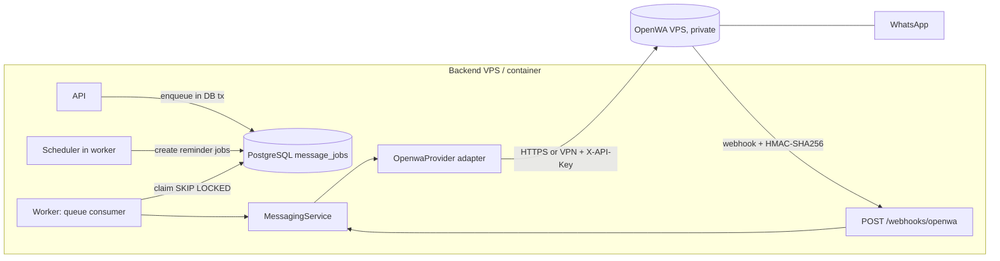

# OPENWA_INTEGRATION

> **Status:** Draft v2 (planned) — supersedes `WAHA_INTEGRATION.md` · **Owner:** Claude (spec) / Freebuff (implementation) · **Updated:** 2026-10-11
> **Depends on:** [DATABASE](DATABASE.md) §3.6, [BILLING_ENGINE](BILLING_ENGINE.md), [SECURITY_AND_PRIVACY](SECURITY_AND_PRIVACY.md) · **Source of truth for:** messaging architecture, queue/retry rules, consent handling, OpenWA security.
> **Change record:** CR-001 · **Supersedes:** ADR-007 (WAHA-first provider), ADR-012 (WAHA Core/Plus tiers). See [DECISIONS](../engineering/DECISIONS.md#adr-017).
> **Provider facts verified against [docs.open-wa.org](https://docs.open-wa.org/) v0.23.5 on 2026-10-11.** Anything not verified below is marked **VERIFY** and blocks M7 until spike S1 records it.

## 1. Read this first: operational reality

OpenWA is an **open-source, self-hosted WhatsApp API gateway** (MIT). It speaks to WhatsApp through one of two interchangeable **unofficial** engines — `baileys` (browser-free WebSocket client) or `whatsapp-web.js` (Chromium/Puppeteer) — selected with `ENGINE_TYPE`. It is **not** the official WhatsApp Business API and is not affiliated with or endorsed by Meta; OpenWA's own docs carry ban-risk guidance and require a reading of "Ban risk & safe sending" before connecting a number (checked 2026-10-11). Consequences the owner must accept (record in [KNOWN_RISKS](../engineering/KNOWN_RISKS.md) R-01):

- Sessions can disconnect at any time (phone offline, logout, QR expiry, WhatsApp-side changes).
- The number can be restricted or banned. **Use a dedicated academy number**, not a personal one, with the account holder's authorization.
- Delivery is best-effort. The system never promises delivery and always offers manual fallback.
- Billing correctness must never depend on messaging (§10).

**Switching from WAHA does not change these risks** — both are unofficial reverse-engineered clients. The risk profile (R-01), the manual-fallback requirement and the "no messaging inside a billing transaction" rule all remain exactly as before.

## 2. Verified vs assumed (checked 2026-10-11)

| ID | Claim | Status | Source |
|---|---|---|---|
| O1 | MIT licensed; **no paid tier and no feature gates**; full feature set open source | **Verified** | [introduction](https://docs.open-wa.org/) |
| O2 | REST API under the `/api` prefix; default port **2785**; interactive Swagger at `/api/docs` | **Verified** | introduction ("A request in practice") |
| O3 | Authentication is **`X-API-Key`** header; keys have roles and **per-key IP allow-lists** | **Verified** | introduction (Feature overview → Auth) |
| O4 | Send text: `POST /api/sessions/{sessionId}/messages/send-text` with `{chatId, text}`, where `chatId` is the international number without `+` plus `@c.us`; returns `{messageId, timestamp}` | **Verified** | introduction (worked curl example) |
| O5 | Webhook headers: `X-OpenWA-Signature` = **`sha256=<hex>` (HMAC-SHA256** over the exact raw body), plus `X-OpenWA-Event`, `X-OpenWA-Idempotency-Key`, `X-OpenWA-Delivery-Id` (stable across retries), `X-OpenWA-Retry-Count` | **Verified** | [webhook-signature-verification](https://github.com/rmyndharis/OpenWA/blob/main/docs/examples/webhook-signature-verification.md) |
| O6 | Signature is present **only when the webhook has a secret**; use constant-time comparison; return 401 on invalid; parse JSON only after verification; return 2xx only once accepted | **Verified** | same |
| O7 | Webhooks are **per-session subscriptions** with HMAC signatures, **automatic retries** and optional pre-dispatch filters | **Verified** | introduction (Feature overview → Webhooks) |
| O8 | Engines: Baileys (browser-free, small footprint, many sessions on modest hardware) or whatsapp-web.js (Chromium, heavier, real browser fingerprint); switch by `ENGINE_TYPE` + restart, **payloads unchanged** | **Verified** | introduction (Engines and adapters) |
| O9 | Adapters by env var: `DATABASE_TYPE` (SQLite default or PostgreSQL), `STORAGE_TYPE` (local filesystem or S3/MinIO), `REDIS_ENABLED` (cache optional) | **Verified** | introduction (The REST API / How it fits together) |
| O10 | Multi-session: several WhatsApp accounts on one instance | **Verified** | introduction |
| O11 | Bundled React dashboard on **the same port** as the API, managing sessions, webhooks and API keys | **Verified** | introduction (Feature overview → Web dashboard) |
| O12 | Message kinds include **documents** (also text, images, video, audio, stickers, reactions, replies, forwards, bulk sends) | **Verified** | introduction (Feature overview → Messaging) |
| O13 | Sessions support **QR-code or pairing-code** auth with lifecycle status tracking | **Verified** | introduction (Feature overview → Sessions) |
| O14 | Operations surfaces exist: `audit`, `metrics`, `health`, `statistics`, `infrastructure` resource tags | **Verified** | introduction (24 resource tags) |
| O15 | Typed SDK `@rmyndharis/openwa` (TS types + typed errors); webhook verify helpers ship from SDK 0.5.0+ | **Verified** | introduction; signature doc |
| O16 | Logout semantics: a `200` means the engine-native unlink **and** local credential cleanup completed — explicitly **not** an independent observation that the handset UI no longer shows the device; reconnect always needs a fresh QR/pairing code | **Verified** | [sessions API ref](https://docs.open-wa.org/api-reference/sessions/) |
| O17 | Webhook secret env var name used in the official example: `OPENWA_WEBHOOK_SECRET` | **Verified** | signature doc (Node + Python examples) |
| O18 | Session lifecycle **status values** (the exact enum strings) | **Partly verified — spike S1 ran 2026-10-15 on the baileys engine with no paired number.** Observed: `created` (in the `POST /api/sessions` 201 body), `initializing` (on `start`), `qr_ready`. `GET /sessions/{id}/qr` → 200 `{qrCode: "data:image/png;base64,…" (~7 KB), status: "qr_ready"}`. **The remaining five names are source-derived, not observed:** `authenticating`, `ready`, `disconnected`, `action_required`, `failed` (`session.entity.ts`). Still open: the connected/recovery names need a paired number | [S1 findings](../engineering/handoffs/2026-10-15-openwa-spike-s1.md) |
| O19 | Delivery/read **(ack) semantics** — whether OpenWA reports server-accepted → device-delivered → read, and how | **Still open — not observable without a paired number.** No `message.*` event fired at all. The only adjacent fact: a failed send persists a row with `status: "failed"` and `waMessageId: null`. **§9.4's rule is unchanged — the adapter may emit only `server_accepted`/`unknown`, and no "Delivered" label** until one real send's progression is observed | [S1 findings](../engineering/handoffs/2026-10-15-openwa-spike-s1.md) |
| O20 | Whether inbound replies (opt-out keywords) are delivered as webhook events, and their payload shape | **Envelope verified; inbound NOT verified.** Envelope on every delivery: `{event, timestamp, sessionId, idempotencyKey, deliveryId, data}`. Observed events: `session.status` → `data: {sessionId, status}`; `session.qr` → `data: {sessionId, qr}` (a **base64 PNG data-URI**, ~9 KB per delivery). **No `message.received` was produced**, so §11's opt-out payload stays doc-derived | [S1 findings](../engineering/handoffs/2026-10-15-openwa-spike-s1.md) |
| O21 | HTTP error codes/bodies for: session not working, number not on WhatsApp, rate limiting | **Partly verified — see §7 for the two corrections this forces.** Session not working is **409** `{"message":"Session is not connected. The WhatsApp client is not ready.","error":"Conflict"}` (not 503); rate limiting is **429** `{"statusCode":429,"message":"ThrottlerException: Too Many Requests"}` with `Retry-After: 1` + `X-RateLimit-*`, reached on the **6th** rapid send; unknown session → 400 `"Session 'x' is not active…"`; non-UUID id → 400 `"Validation failed (uuid is expected)"`. **A malformed recipient also returns 409** (the session check precedes recipient validation) → **409 must never map to `INVALID_RECIPIENT`**. **"Number not on WhatsApp" NOT observed** — the `INVALID_RECIPIENT` row stays unconfirmed | [S1 findings](../engineering/handoffs/2026-10-15-openwa-spike-s1.md) |
| O22 | Webhook retry schedule/backoff (automatic retries are confirmed; the timing is not) | **Partly verified.** First retry arrived **~5.1 s** after the failed attempt (matches `WEBHOOK_RETRY_DELAY=5000`); `X-OpenWA-Retry-Count` is **0-based** (`0` first attempt, `1` first retry); **`X-OpenWA-Delivery-Id` is stable across the retry** (so §9's dedupe premise holds). Refined for §9: both the delivery id and the idempotency key are **per subscription, not per event** — one event delivered to three subscriptions produced three different ids, and the idempotency key's last segment is the webhook id. **The multiplier for 2nd+ retries was not observed** (probe limitation) — the doubling is still code, not measurement | [S1 findings](../engineering/handoffs/2026-10-15-openwa-spike-s1.md) |
| O23 | Cost | **Verified: none.** MIT, self-hosted, no per-message or per-tier fee (O1) | introduction |

**Spike S1 (first task of M7, Freebuff):** deploy OpenWA on the target VPS (Docker, `ENGINE_TYPE` per §12), link the dedicated number, then record the real values for **O18–O22** in an ADR-017 addendum with logs/screenshots — including one text message's full status progression and one deliberately-unsigned webhook. Update this table. **No M7 code merges until S1 is documented.**

> **S1 ran on 2026-10-15 against a local, unpaired gateway and answered the unauthenticated half of that brief** — [findings](../engineering/handoffs/2026-10-15-openwa-spike-s1.md). It also verified two things this table previously took from documentation: **O5/O6's signature rule by observation** (a webhook with a secret receives `X-OpenWA-Signature: sha256=<hex>`; an identical one without a secret receives **no signature header at all**, which is why §9 treats a missing header as a rejection), and the **`message.sent`/`message.ack`-family event names remain unobserved**. The parts that need the number are listed there under "what is still required"; **O19 is untouched and still blocks §9.4**.

> **Why this table matters:** the previous WAHA spec asserted `X-Webhook-Hmac`/SHA-512, an ack enum of −1…4, `WORKING`/`SCAN_QR_CODE` status names and Core-vs-Plus tiers. **None of those carry over.** Do not copy them here — OpenWA uses `X-OpenWA-Signature`/SHA-256 and a different lifecycle and error surface.

## 3. Architecture



- **Provider independence ([ADR-007](../engineering/DECISIONS.md#adr-007), still in force):** domain code (billing, reminders) calls only `MessagingService.enqueue(...)`. The `MessagingProvider` port defines the capabilities: `sendText(toE164, body, clientRef)`, `sendDocument(toE164, fileRef, caption)` *(now a first-class supported capability, not a paid-tier extra — O12)*, `getHealth()`, `verifyAndParseWebhook(rawBody, headers) → NormalizedEvent[]`. Only `OpenwaProvider` imports OpenWA types, paths or header names. `NormalizedEvent` = `{ kind: 'ack'|'session'|'inbound', providerMessageId?, ack?, sessionStatus?, fromE164?, text?, occurredAt }`.
- OpenWA is called **only from the backend worker/API**; the browser never sees the OpenWA hostname, API key or payloads.
- No OpenWA call occurs inside a database transaction that changes billing/registration data.
- **Dedupe support is stronger than the previous provider's:** OpenWA supplies `X-OpenWA-Idempotency-Key` and a `X-OpenWA-Delivery-Id` stable across retries (O5), so the webhook handler stores delivery ids and drops repeats (§9).

## 4. Message kinds and delivery modes

| Kind | Trigger | Dedupe key |
|---|---|---|
| `invoice_delivery` | after `BIL-02` with `queueWhatsApp`, or manual `INV-08` | `invoice_delivery:{invoiceId}:{guardianId}` (manual resend: `…:manual:{Idempotency-Key}`) |
| `reminder_pre_due` | scheduler, rule `offsetDays` before `due_date` | `reminder_pre_due:{invoiceId}:{guardianId}:d{offset}` |
| `reminder_overdue` | scheduler, rule `offsetDays` after `due_date` | `reminder_overdue:{invoiceId}:{guardianId}:d{offset}` |

`dedupe_key` is `UNIQUE`; enqueue uses `INSERT … ON CONFLICT DO NOTHING`, so repeated scheduler runs or double clicks cannot create duplicates.

**Automation gating (CR-003, [ADR-019](../engineering/DECISIONS.md#adr-019)):** every kind above is enqueued/sent only when **all** hold — the master `messaging_automation_enabled` (MSG-07), that kind's per-automation flag in `SET-08` (`invoiceDelivery`, `reminderPreDue`, `reminderOverdue`), OpenWA health healthy (§8) and the guardian's consent (§11). The owner sees these as one list of switches ("Invoices", "Pre-due reminders", "Late (overdue) reminders" = `reminder_overdue`, "Bank-transfer proof checks"). Turning one off stops new enqueues and cancels that kind's unsent jobs; turning it back on **never back-fills** missed sends. A **manual** invoice send (`INV-08` / billing-wizard `queueWhatsApp`) is an explicit owner action: the per-automation flag does not block it, master pause/health/consent still do.

**Invoice delivery mode** (`academy_settings.messaging_invoice_mode`):

| Mode | Behaviour | Requires |
|---|---|---|
| `link` (default) | Text message containing a **secure expiring link** (`invoice_access_tokens`) to the PDF | Nothing beyond a working session |
| `attachment_and_link` | Sends the PDF as a **document** message, plus the link in the text | A passing S1 media test (O12 confirms documents are supported; the per-engine file limit and MIME handling still need S1) |

The link is a **capability URL** ([FILES_AND_PDF](FILES_AND_PDF.md) §6): 256-bit token, hash-only in DB, TTL `invoice_link_ttl_days`, revoked on void.

> **Difference from the WAHA spec:** `attachment_and_link` was previously gated behind a paid "Plus" tier (old ADR-012). OpenWA has no tiers (O1), so the mode is now gated on **a successful spike test only**, not on a purchase. `OPEN-002` is therefore resolved — see [OPEN_DECISIONS](../engineering/OPEN_DECISIONS.md).

## 5. Templates (defaults; owner-editable)

Variables: `{{guardianName}} {{playerName}} {{invoiceNumber}} {{amountDue}} {{dueDate}} {{invoiceLink}} {{academyName}}`. Amounts are rendered at **send time** from the current invoice (so partial payments are reflected): `LKR 2,500.00`.

```
invoice_delivery:
Hello {{guardianName}}, this is {{academyName}}. Invoice {{invoiceNumber}} for {{playerName}} is ready.
Amount due: {{amountDue}} · Due: {{dueDate}}
View/download: {{invoiceLink}}
Reply STOP to stop these messages.

reminder_pre_due:
Hello {{guardianName}}, a friendly reminder from {{academyName}}: invoice {{invoiceNumber}} for {{playerName}} ({{amountDue}}) is due on {{dueDate}}. {{invoiceLink}}
Reply STOP to stop reminders.

reminder_overdue:
Hello {{guardianName}}, invoice {{invoiceNumber}} for {{playerName}} ({{amountDue}}) was due on {{dueDate}}. If you have already paid, please ignore this message. {{invoiceLink}}
Reply STOP to stop reminders.
```
Rules: no message may contain payment-proof content or other children's names; one invoice per message. Siblings = separate messages (separate invoice, separate link). Sinhala/Tamil templates are a later option [OPEN-013] (UTF-8 supported by design).

## 6. Queue, scheduler, pacing

**Queue:** `message_jobs` itself (no Redis for *our* queue — [ADR-005](../engineering/DECISIONS.md#adr-005); note OpenWA's own optional Redis, O9, is unrelated to this). Worker loop every 5 s:

1. If `messaging_automation_enabled = false` **or** latest OpenWA health ≠ healthy → claim nothing. Otherwise claim normally, then check the claimed job's **kind** flag (SET-08): if that automation is off → `cancelled` + `skipReason='AUTOMATION_DISABLED'`, **without consuming an attempt**, and continue with the next job (the check is per job, so a switch flipped while jobs are queued takes effect immediately).
2. Claim ≤ 1 job: `WHERE status IN ('queued','failed') AND scheduled_for <= now() AND next_attempt_at <= now() ORDER BY scheduled_for FOR UPDATE SKIP LOCKED`; set `status='sending'`, `locked_by`, `locked_at`, `attempts = attempts+1`; commit **before** any HTTP call.
3. Pre-send checks (in a fresh read): invoice exists and not `void`/`paid` (for reminders: balance > 0); guardian `whatsapp_consent='granted'` and not opted out; player not withdrawn-with-stop; inside send window (else `scheduled_for = next window start`); otherwise mark `skipped` with `skip_reason` + event.
4. Render template → store `rendered_body`; call provider (`sendText`/`sendDocument`, §3).
5. Success (provider accepted, returns `messageId` per O4) → `status='sent'`, `provider_message_id`, `delivery_state='server_accepted'`, `sent_at`. **"Sent" means accepted by OpenWA, nothing more.**
6. Failure → classify per §7.

**Pacing (anti-ban, assumption not from OpenWA docs):** one sender (global advisory lock), random delay 20–60 s between sends, ≤ 40/hour, send window default 09:00–19:00 Asia/Colombo. Configurable in `SET-07`. A monthly run of ~100 invoices therefore drains in ~1–2 hours.

**Scheduler (inside worker, advisory-locked so only one runs):**
- Daily 08:30 academy time: for each active `reminder_rules` row whose **automation flag** is on (SET-08: `pre_due` → `reminderPreDue`, `overdue` → `reminderOverdue`), find invoices (`issued`/`partially_paid`) with `due_date = today ± offset`; for each guardian with `receives_invoices`, consent `granted`, not opted out → enqueue (dedupe_key). Backfill-safe: running twice enqueues nothing new. With a flag off, the run is skipped for that kind and nothing is enqueued or back-filled when it is switched back on.
- Every 60 s: OpenWA health check (§8). Every 15 min: stuck-job sweep (`sending` older than 10 min ⇒ `needs_review`, **never auto-resent**).
- Reminders for an invoice stop automatically when it becomes `paid`/`void` (pre-send check + cancellation in the void/payment transactions).

## 7. Retry policy and failure classification

| Situation | Action | Counts attempt? |
|---|---|---|
| Connection refused / DNS failure (request never reached OpenWA) | `failed`, retry with backoff | yes |
| HTTP 429 or 503 | `failed`, retry with backoff (honor `Retry-After` if present) | yes |
| OpenWA says session not working / not authenticated — **observed: `409` + `"Session is not connected. The WhatsApp client is not ready."`** (S1, O21) | defer `next_attempt_at = now + 15 min`; set health `down`; pause queue | **no** |
| Request timeout or connection reset **after** the request may have been sent; other 5xx | `needs_review` (message **may** have been delivered; **no auto-retry**) | yes |
| 4xx invalid/unsupported recipient (e.g. number not on WhatsApp) — **code still unconfirmed** (needs a live session; S1 could not produce one) | `dead` with `last_error_code='INVALID_RECIPIENT'`; owner sees "use manual fallback" | yes |
| Attempts exhausted | `dead` | — |

> **Two traps S1 found in this table (O21).** (1) "Session not working" is a **409**, so nothing may match it as a 5xx — a 5xx match would route it to `needs_review` ("the message may have been delivered") when nothing was sent at all. (2) **A malformed recipient also answers 409**, because the session check runs *before* recipient validation. **409 must therefore never be classified as `INVALID_RECIPIENT`** — telling an owner "this number isn't on WhatsApp, use the manual fallback" while the real problem is a disconnected session is exactly the wrong instruction. While the session is down, recipient faults are not observable at all, so the recipient row needs a healthy session to be exercised before it can be trusted. Also (3): the gateway's own throttle is **much tighter than §6's pacing** — a 429 arrived on the **6th** rapid send — so 429 is ordinary backpressure, not an incident.

Backoff for retriable failures: 1 min, 5 min, 30 min, 2 h, 6 h (±20 % jitter), `max_attempts = 5`. Dead-letter = status `dead`; shown in the owner UI with last error, retry button (resets attempts to 0 after re-checking consent/invoice state) and **manual fallback** (owner contacts the guardian themselves, taps "Mark sent manually", which stops further automation for that job).

At-most-once rationale: for money reminders a missed message is recoverable (owner sees it), a duplicate message is a trust problem; hence ambiguous outcomes go to `needs_review`, not auto-retry. OpenWA's *inbound* webhook retries (O7) are handled separately by delivery-id dedupe (§9), so the two retry layers cannot double-send.

## 8. Session monitoring

- Every 60 s the worker calls OpenWA's session endpoint (`GET /api/sessions/{sessionId}`) and stores `integration_health(integration='openwa')` with a normalized status (`healthy` iff OpenWA reports the session as connected — **observed (S1, O18): only `ready` means connected; `created`, `initializing` and `qr_ready` were seen unpaired and all read as not healthy; the five connected/recovery names are still source-derived**).
- **Address the session by its UUID, not its name (S1, O21).** `GET /api/sessions/{id}` answers `400 "Validation failed (uuid is expected)"` for anything that is not a UUID, so `OPENWA_SESSION_ID` must be the id returned when the session was created — the human name (`ia-spike-s1`) is the more natural value to try and it does not work. A 400 here means the session is wrong or absent, which must map to health **`down`** — not `unknown`, which §8 reserves for "no successful check in 5 min".
- Webhook `session`-class events update health immediately.
- On transition to not-healthy: queue claims stop; owner dashboard shows a red banner "WhatsApp disconnected — reminders paused" with instructions to re-scan the QR **or enter the pairing code** (O13) via the OpenWA dashboard (over VPN).
- If no health check has succeeded for 5 min, status = `unknown` and the queue stays paused.
- **Reconnect note (O16):** after a successful logout/unlink the credentials are wiped, so recovery always requires a fresh QR scan or pairing code — plan for that in the runbook rather than expecting a silent reconnect.
- Optional daily digest email to owners [OPEN-012]; v1 minimum: banner + `/system/health` + external uptime monitor on `/ready`.

## 9. Webhook handling

`POST /api/v1/webhooks/openwa`:
1. Read the **raw** body bytes. Compute **HMAC-SHA256** with the shared secret; compare with the `X-OpenWA-Signature` header value, which arrives formatted as `sha256=<hex>`, using a **constant-time** comparison; reject (401, no body details) on mismatch, malformed value or missing header (O5, O6). Verify **before** JSON parsing. If the subscription was created without a secret, OpenWA sends no signature — **we always configure a secret**, and a missing header is therefore treated as a rejection, not as "unsigned is fine". **S1 confirmed both halves of this by observation:** a subscription created with a secret received `X-OpenWA-Signature: sha256=<64 hex>` on every delivery, and an otherwise identical subscription created without one received **no signature header at all**.

> **Dedupe detail refined by S1 (O22): both ids are per *subscription*, not per event.** One `session.status` event delivered to three subscriptions produced three different `X-OpenWA-Delivery-Id` values, and `X-OpenWA-Idempotency-Key` carries the **webhook id** in its last segment (`sess_<sessionId>_<status>_<ISO>_<webhookId>`). Deduping on either is still correct and still required, but the key is scoped to a subscription — it will not catch the same event delivered twice through two subscriptions.
2. Reject bodies > 256 KB; proxy-level IP allowlist for the OpenWA host as a second layer.
3. **Dedupe first:** ignore a delivery whose `X-OpenWA-Delivery-Id` has been seen (O5, O7); log `X-OpenWA-Retry-Count` for diagnostics. This is required because OpenWA retries automatically and may deliver out of order.
4. Normalize `X-OpenWA-Event` + body to `NormalizedEvent[]`.
5. `ack`-class events: find job by `provider_message_id`; **monotonic update**; map to `delivery_state` **once O19 is confirmed in S1**. Until then the adapter must only ever produce `server_accepted` or `unknown` — **it must not emit `device_delivered`/`read` on assumption.** The UI label **"Delivered" appears only for a provider-reported delivered state**; "Sent" for `sent`/`server_accepted`. Unknown id → log + 204.
6. Inbound/opt-out events (**shape: S1, O20**): only the exact configured opt-out keywords (case-insensitive, trimmed) from a number matching a known guardian are acted on (§11). **Message content is not stored**; everything else is dropped.
7. Always respond 2xx/204 quickly **after** the event is safely accepted (O6); processing is idempotent.

## 10. Failure isolation

- Enqueue happens in the same DB transaction as the business event **or** later by the scheduler; sending is always a separate step. An OpenWA outage leaves invoices/payments untouched and only produces `failed`/`needs_review`/`queued` jobs.
- Worker crash mid-send leaves a `sending` row → sweep → `needs_review`.
- Every message state change is an event row; nothing is "lost" silently.

## 11. Consent and opt-out

| State | Automated messages? |
|---|---|
| `granted` and not opted out | yes |
| `unknown` (default for imports / legacy) | **no** — owner must record consent (source: registration form, verbal, WhatsApp reply, owner entry) |
| `revoked` / `opted_out_at` set | **never**; queued jobs cancelled immediately |

- Registration form wording (put on the paper/online form): *"I agree that Inspire Academy may send fee invoices and reminders to this number via WhatsApp. I can opt out at any time by replying STOP or telling the academy."*
- Opt-out sources: guardian replies a keyword (webhook), or owner records it (GDN-05). Both audit-logged; opt-out confirmation message is **not** auto-sent in v1 (avoids messaging someone who opted out).
- Consent is per guardian (shared across siblings). Owner can pause **all** automation instantly (MSG-07) and switch each automation off individually (SET-08, [ADR-019](../engineering/DECISIONS.md#adr-019)). Consent is per guardian and is unaffected by either switch — a guardian who never consented is never messaged, whatever the owner enables.

## 12. Security and network

| Control | Spec |
|---|---|
| Placement | OpenWA on its own small VPS (or isolated Docker network) — never co-located with the database. |
| Exposure | **No public OpenWA port.** Reach it via private network/VPN (WireGuard/Tailscale) **or** firewall to allow only the backend's IP; TLS on any hop crossing a public network. |
| API auth | **`X-API-Key`** on every call (O3). Key ≥ 32 random bytes. Prefer a **scoped operator key limited to the academy session** (session-scoped keys exist, O3) over an unscoped admin key, so a leaked key cannot touch other sessions. |
| IP allow-list | Use OpenWA's **per-key IP allow-list** as defence in depth (O3), restricting the key to the backend's egress IP. |
| Dashboard / Swagger | The React dashboard and `/api/docs` are served on **the same port as the API** (O2, O11), so they are reachable wherever the API is. Disable or password-protect at the reverse proxy and keep them VPN-only; operator-only for QR scanning. |
| Secrets | `OPENWA_BASE_URL`, `OPENWA_API_KEY`, `OPENWA_SESSION_ID`, `OPENWA_WEBHOOK_SECRET` in the backend secret store only; never in frontend, logs, `message_events.payload`, or errors. (Webhook secret name matches the official example, O17; the other three are our own naming — exact OpenWA-side env var names: S1.) |
| Webhook | HMAC-SHA256 verification (§9) + IP allowlist + HTTPS. **Algorithm differs from the previous provider (SHA-256, not SHA-512).** |
| Webhook filters | OpenWA supports optional pre-dispatch filters per subscription (O7) — use them to send only the event classes we consume, shrinking the attack surface. |
| Engine choice | Default `ENGINE_TYPE` = **`baileys`** (browser-free, no Chromium on the VPS → smaller attack surface and memory footprint; O8). Revisit only if a whatsapp-web.js-specific capability is needed. Recorded as safe default, not a verified requirement. |
| Rotation | Every 6 months or on suspicion: generate new key/secret → set on OpenWA and backend secret store → restart both in a maintenance minute → verify `/messaging/status` + test message → destroy old values. Record in operations log. |
| Account | Dedicated number, owner-authorized, SIM/phone kept online; record who holds the phone in the handover doc. |
| Test endpoint | `MSG-08` can only message an owner's own number. |

## 13. Monitoring and recovery

| Alert condition | Where it shows | Runbook |
|---|---|---|
| OpenWA session not healthy > 2 min | Dashboard banner, `/system/health` | Re-scan QR or enter pairing code; if repeated, check phone connectivity |
| `dead` jobs > 0 in last 24 h | Messages page badge | Review → retry or manual fallback |
| `needs_review` > 0 | Messages page badge | Check the guardian's chat / OpenWA log; mark manual or retry |
| Queue age (oldest `queued`) > 3 h inside window | `/system/health` | Check worker running, pacing settings, health |
| OpenWA container restarts | Host monitoring | Check session persistence volume (`DATABASE_TYPE`/storage backend) |

Recovery after OpenWA data loss: re-create the session, re-scan QR / re-enter pairing code, no business data lost; pending jobs resume. Back up OpenWA's session volume and its database (SQLite file or PostgreSQL) — it is a secret store, so encrypt it.

## 14. Migration path to the official WhatsApp Business Platform

Triggers: repeated bans/disconnects, policy requirement, volume growth. Because of the provider port: implement `CloudApiProvider`; business-initiated messages need **pre-approved templates** and recipient opt-in under Meta's rules; delivery/read statuses arrive via Meta webhooks and map onto the same `NormalizedEvent.ack`; conversation-based pricing applies (verify current pricing before deciding). Invoice PDFs go as document messages. No schema change expected except `messaging_provider` value and a template-id mapping table. Cut over with `messaging_provider` flag and a test run to an owner number.
