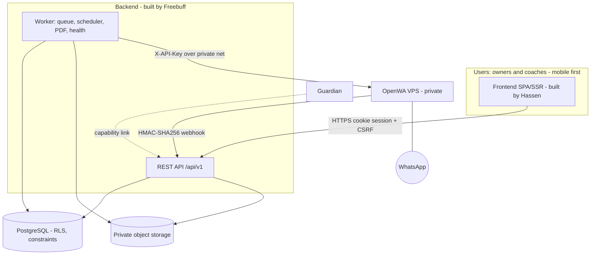
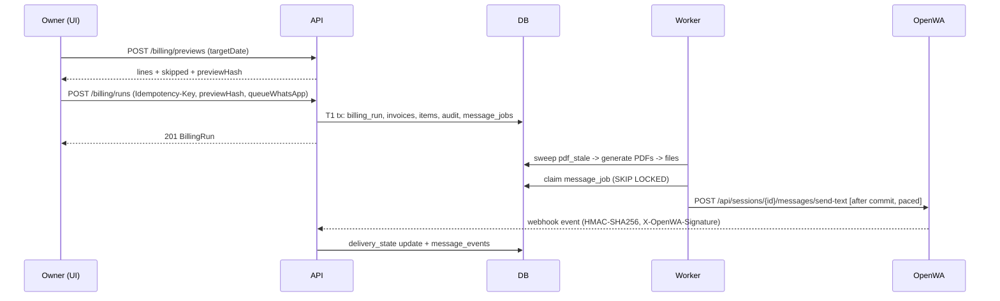

# OVERVIEW

> **Status:** Draft v1 (planned, nothing implemented) · **Owner:** Claude · **Updated:** 2026-10-11
> **Source of truth for:** system boundaries, component responsibilities, stack summary. Detailed decisions: [DECISIONS](../engineering/DECISIONS.md).

## 1. What is being built

A secure, mobile-first management system for **one** football academy (Inspire Academy): players & guardians, age groups, coaches, sessions & attendance, coach check-in, fees/invoices/payments/receipts (LKR), PDF documents, WhatsApp invoice delivery and reminders via OpenWA, reports, audit. Owners and coaches only.

**Out of scope (v1):** public website, parent accounts/portal, online payment gateway, accounting software, multi-tenant SaaS, native mobile apps, AI features. Extension points (provider port for messaging, role/permission strings, API versioning) exist, but nothing beyond scope is designed in.

## 2. Repository audit result (M0)

| Check | Finding (2026-10-11) |
|---|---|
| Existing source / README / `CLAUDE.md` / manifests | **None found.** Greenfield; no stack to preserve. |
| Logo / brand assets | **None provided.** Not invented; see [FILES_AND_PDF](FILES_AND_PDF.md) §1. |
| Installed skills inspected | `engineering:architecture` (ADR format), `engineering:system-design`, `engineering:testing-strategy`, `engineering:documentation` read and applied. Not used: no messaging/security/PDF skill exists. The `docs` skill targets Claude Docs, not repo Markdown. |
| External research | **OpenWA** (introduction, webhook signature verification, sessions API) fetched/searched on 2026-10-11 from [docs.open-wa.org](https://docs.open-wa.org/) — see [OPENWA_INTEGRATION](OPENWA_INTEGRATION.md) §2. The previously researched provider (WAHA) was replaced by the owner on 2026-10-11 (CR-001 / ADR-017). Other framework/database/storage facts are standard, widely documented behaviour **not re-fetched this session**; Freebuff must confirm them against current official docs in M1 (listed in [KNOWN_RISKS](../engineering/KNOWN_RISKS.md) R-14). |

## 3. Components

| Component | Responsibility | Does NOT do |
|---|---|---|
| Frontend (Hassen) | UI, client validation (UX only), formatting in academy timezone, caching of GETs | Authorization, money math beyond display, any OpenWA/storage secret |
| API (Freebuff) | AuthN/Z, validation, business rules, transactions, audit, contract enforcement | Long-running work, direct OpenWA calls inside request transactions |
| Worker (same codebase, separate process) | Message queue consumer, reminder scheduler, session generator, billing scheduler, PDF generation, OpenWA health, sweepers | Serving HTTP to users |
| PostgreSQL | Source of truth; constraints, exclusion constraints, deferred integrity triggers, RLS backstop | Business workflows beyond invariants |
| Object storage | PDFs, proofs, logo (private) | Metadata queries |
| OpenWA | WhatsApp session + HTTP gateway | Business logic; it is replaceable behind `MessagingProvider` |

## 4. Stack summary (all recorded as ADRs)

| Layer | Choice | Why (short) | Alternative considered |
|---|---|---|---|
| Frontend | Next.js + TypeScript (Hassen's call; contract is framework-agnostic) | Hassen's existing tooling; SSR optional | Any SPA — contract unchanged |
| Backend | Node.js LTS + TypeScript, Fastify, Zod schemas → OpenAPI | One language with the frontend; schema-first contract; small and fast | NestJS (heavier), Python/FastAPI (second language) |
| DB | PostgreSQL 16+ (managed, PITR) | Constraints, exclusion constraints, RLS, transactions | MySQL (weaker constraints), Supabase-only (same Postgres, optional host) |
| Auth | Own cookie sessions in Postgres | No third-party lock-in; revocation trivial; no JWT-in-browser | Auth provider (adds cost/dependency), JWT (revocation harder) |
| Queue/scheduler | Postgres table + `SKIP LOCKED` worker, in-process scheduler with advisory lock | No Redis to run/secure at this scale | BullMQ/Redis, pg-boss |
| PDF | Server-side library (PDFKit) with Chromium fallback | Deterministic, light; Sinhala/Tamil spike P1 | Headless Chromium first |
| Storage | S3-compatible private bucket | Standard presign semantics | DB blobs (rejected by requirements) |
| Messaging | OpenWA behind a provider port (MIT, self-hosted, no tiers) | Chosen by the owner (ADR-017); replaceable | Official WhatsApp Business API (migration path §14 of [OPENWA_INTEGRATION](OPENWA_INTEGRATION.md)) |
| Hosting | See [DEPLOYMENT_AND_OPERATIONS](DEPLOYMENT_AND_OPERATIONS.md) | Simplest secure topology | Kubernetes etc. — rejected, no requirement |

Freebuff may propose a different backend framework/tool **only** through [CHANGE_MANAGEMENT](../engineering/CHANGE_MANAGEMENT.md), and **must** keep the API contract, DB invariants and security rules unchanged.

## 5. Major data flows

**A. Monthly billing → WhatsApp**

> Delivery/read progression is **not yet verified** for OpenWA ([OPENWA_INTEGRATION](OPENWA_INTEGRATION.md) O19, spike S1). Until it is, the UI must only ever show "Sent" (provider accepted) and never "Delivered" — see the rule in §4 of the integration doc.

**B. Payment**: Owner records payment (cash → `confirmed`; transfer → optionally `pending` + proof) → T2 locks payment+invoices, allocates, updates balances, creates receipt → worker generates receipt PDF → owner can view/forward. Proof never changes status by itself.

**C. Attendance**: Scheduler generates sessions → coach opens session (scope-checked) → bulk save with idempotency → audit on changes → reports.

**D. Reminder**: Daily scheduler enqueues deduped jobs per rule → worker re-checks invoice / consent / master pause + that kind's automation switch (SET-08, CR-003) / send window → send or skip with reason.

## 6. Workload and performance assumptions

~100–600 players, 1–10 coaches, 1–3 owners; < 10 concurrent users; ≤ 10k invoices/yr; ≤ 100 WhatsApp messages/day; ≤ 5 MB files. One small API instance + one worker + one DB is sufficient. No caching layer in v1 (HTTP `ETag` on reference lists only). Pagination everywhere ≥ 25 rows; N+1 avoided via joins/batch loads; list endpoints must have a documented index ([DATABASE](DATABASE.md) §9). Structured JSON logs with request ids; metrics: request rate/latency/error, queue depth, job age, PDF stale count, OpenWA health. DB growth ≈ tens of MB/year (files excluded). Revisit when players > 2,000 or multiple academies are requested (that is a re-architecture, not a toggle).

## 7. Dependency and upgrade policy

Pin versions (lockfile committed). Monthly: `npm audit`/OSV scan + dependabot-style PRs; security fixes within 7 days; Node LTS upgrade within 3 months of a new LTS; PostgreSQL major upgrade planned with restore-tested dry run. Frameworks upgraded one major at a time on a branch with the full test gate ([TESTING_AND_ACCEPTANCE](../engineering/TESTING_AND_ACCEPTANCE.md)).
