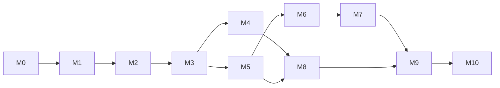

# IMPLEMENTATION_PLAN

> **Status:** Draft v1 · **Owner:** Claude (plan) · **Updated:** 2026-10-11
> Ownership: **F** = Freebuff (backend), **H** = Hassen (frontend), **J** = joint integration. A milestone exits only with the listed **evidence**; "documented" never counts as done ([CONTINUATION_GUIDE](CONTINUATION_GUIDE.md)).

## 1. Dependency order

Frontend work for milestone *N* may start after its API contract is frozen at M1 (using mocks) and integrates (J) when Freebuff's endpoints for *N* are verified. Each milestone ends with a **demoable end-to-end slice**.

## 2. Milestones

### M0 — Audit, requirements, decisions (Claude) — **DONE**
Deliverable: this repository. Evidence: files exist; [PROJECT_STATUS](PROJECT_STATUS.md).

### M1 — Contracts, schema, security model, UI specs finalised (F review + H review + Claude)
| Owner | Tasks |
|---|---|
| F | Review DATABASE/BILLING/AUTH for implementability; verify framework/DB/storage facts against official docs and record sources in DECISIONS (R-14); confirm ADR-001/008 or propose alternatives; produce `api/openapi.yaml` from API_CONTRACTS; list spec gaps/ambiguities in a HANDOFF report |
| H | Review page specs/routes; confirm framework (OPEN-021); scaffold app shell and MSW mocks from MOCK_DATA; list missing endpoints/fields |
| Claude | Reconcile findings, update docs together, resolve/record OPEN items |
**Entry:** M0 done. **Exit evidence:** `openapi.yaml` committed and validates; frontend generated types compile; zero unresolved "contract gap" items; OPEN-021/003/006/018 answered or defaults accepted in writing; PROJECT_STATUS updated. **Blockers:** owner answers.

### M2 — Auth, roles, DB foundation, app shell (F, H, J)
| F | Repo, CI, migration tooling, base schema (settings, users, sessions, invites, audit, idempotency, counters), DB roles + RLS framework + context middleware, error format, request ids, rate limit, CSRF, security headers, health endpoints, route permission registry, bootstrap `create-owner`, mock messaging provider scaffold |
|---|---|
| H | App shell, login/accept-invite/profile, nav per `permissions`, API client, error/permission states, design tokens |
**Exit evidence:** T-AUTH-01,02,07,08,09; T-DB-RLS-03; T-SEC-01,02,05; owner and coach can sign in on staging; invite flow works; CI green. **Demo:** owner invites coach; coach logs in and sees only coach shell.

### M3 — Players, guardians, age groups, assignments (F, H, J)
F: age_groups, group_fees, players, guardians, links, history, assignments, duplicate check, suggestion, consent endpoints, coach projections, audit; CSV import (validate/commit). H: players list/register/profile, groups/fees, coaches pages, import wizard. **Exit:** T-PLY-*, T-GRP-01, T-AUTH-03,05,06, T-DB-RLS-02. **Demo:** register player (duplicate warning), assign group, transfer with history.

### M4 — Sessions, attendance, coach attendance (F, H, J)
F: schedules, generator, sessions, attendance (bulk, corrections, versions), coach check-in/out + owner corrections, coach-time aggregates for the dashboard. H: sessions list/page, **mobile attendance sheet**, check-in bar, **one-tap coach clock in/out on the coach dashboard (CR-003: no dialog, ≥ 48 px, elapsed while open, own weekly hours)**, coach attendance page, local draft. **Exit:** T-ATT-* (**incl. T-ATT-11**), T-AUTH-04, T-UI-02 and **T-UI-10** (device pass). **Demo:** coach on a phone takes attendance for a 20-player roster in < 60 s, and clocks in/out in one tap.

### M5 — Billing rules, invoices, payments, allocations, receipts (F, H, J)
F: settings billing, preview/run/scheduler, invoices, items, adjustments, void, payments, allocations, proofs metadata endpoints (storage stubbed with local MinIO), receipts rows, invariant triggers/job, idempotency; **bank-transfer proof verification (CR-003 + CR-004)**: a deterministic **per-bank receipt parser + text-layer extraction** (parser version stored with each result), stored `doc_kind` + findings, running in the **sandboxed** parsing path — advisory only, **never an auto-confirm** ([PAYMENT_VERIFICATION](../architecture/PAYMENT_VERIFICATION.md), [ADR-020](DECISIONS.md#adr-020)/[ADR-021](DECISIONS.md#adr-021)). H: billing wizard, invoices, payments, record-payment with allocation editor, credit, **Verification queue + proof-verification panel on `/payments`** (findings per check, and the **PDF-first** prompt — "A photo can't be verified — ask for the PDF", owner-side copy/`wa.me` request; no new message kind, [OPEN-025](OPEN_DECISIONS.md)). **Exit:** all T-FIN-* (**incl. T-FIN-20**), **T-VER-01..06**, T-RPT-02, **T-UI-12**; concurrency tests green 100 consecutive runs; owner can complete the monthly cycle on staging. **Demo:** issue November invoices, record partial + full payments, void and reissue.

### M6 — PDF generation and secure file storage (F, H)
F: **Spike P1 first** (Sinhala/Tamil), PDF worker (invoice, receipt), storage integration (private bucket), proof upload validation, signed URLs, invoice access tokens + public route; **proof-parsing hardening (CR-004)**: active-content re-check before parsing, **no server-side rendering**, no external fetches, bounded CPU/memory sandbox (a crash fails one proof, never the request), extracted values treated as proof-class PII — see [PAYMENT_VERIFICATION](../architecture/PAYMENT_VERIFICATION.md) §6. H: PDF buttons/viewer behavior, proof upload UI, receipts. **Exit:** T-FIL-*, **T-VER-03**; manual visual review of invoice/receipt samples by Hassen + owner. 

### M7 — OpenWA integration, reminders, queue, monitoring (F, H, J)
F: **Spike S1 first** — deploy OpenWA on the target VPS, link the dedicated number, then record its real values for O18–O22 (session status enum, delivery/ack semantics, inbound event shape, error codes, webhook retry timing) in [OPENWA_INTEGRATION](../architecture/OPENWA_INTEGRATION.md) §2 with logs before any M7 code merges. Then: provider port + OpenWA adapter + mock provider, queue worker, scheduler, retry/needs_review rules, webhook handler (`X-OpenWA-Signature`, HMAC-SHA256), health monitor, consent/opt-out, templates/rules endpoints. H: WhatsApp pages (status, messages, rules/templates, settings), **Automations list + per-automation switches (`SET-08`, CR-003/ADR-019)**, billing wizard WhatsApp option. **Exit:** T-MSG-01..**14**, T-MSG-SEC-01/02, T-UI-08, **T-UI-11**; real-number test to an owner phone. **Blockers:** dedicated number + VPS. *(OPEN-002 is resolved: OpenWA is MIT with no tiers — [ADR-017](DECISIONS.md#adr-017).)*

### M8 — Dashboard, reports, exports (F, H)
F: dashboard endpoints, report endpoints, CSV streaming with injection protection, audit view, system health. H: dashboards, reports, audit, system pages. **CR-003:** the owner dashboard's **"Coaches today"** card (checked in now + today/week coach hours + open check-ins needing correction) and the coach's own weekly hours on `DSH-02`. **Exit:** T-RPT-*, T-UI-09, **T-ATT-11, T-UI-10**; numbers reconcile with BILLING_ENGINE §14 fixtures.

### M9 — Integration, security, accessibility, regression (J)
Full E2E suite, perf sanity (list endpoints with 5k invoices/20k attendance rows < 300 ms p95 on target hardware), security review, a11y pass, bug bash with real academy data (anonymised copy in staging), fix backlog. **Exit:** release gate items 1–3, 5, 7, 8.

### M10 — Deployment, backup/restore, handover, release (F, H = operator, J)
Provision prod, secrets, DNS/TLS, OpenWA VPS hardening, monitoring, backups, **restore test**, first owner + TOTP, initial configuration, CSV import of real players, owner training, handover pack, go-live. **Exit:** release gate fully satisfied; PROJECT_STATUS records dates and evidence.

## 3. Cross-milestone rules
- Backend never merges an endpoint that isn't in the contract; frontend never calls one that isn't.
- Each PR/report uses [HANDOFF_TEMPLATE](HANDOFF_TEMPLATE.md).
- Scope changes → [CHANGE_MANAGEMENT](CHANGE_MANAGEMENT.md).
- If a milestone's exit evidence is partial, the milestone stays **In progress** and the gap is listed in PROJECT_STATUS.
- **Mobile is a shipping requirement, not a polish task (CR-003):** every new surface (coach clock in/out, automation switches, verification queue, dashboard cards) must be usable one-handed at 360 px with ≥ 44 px targets, and is checked on a real phone at its own milestone exit — not deferred to M9. Desktop-only affordances (hover-only menus, dense tables without a card fallback, dialogs that hide the primary action) are defects. The academy runs on phones at the pitch.
